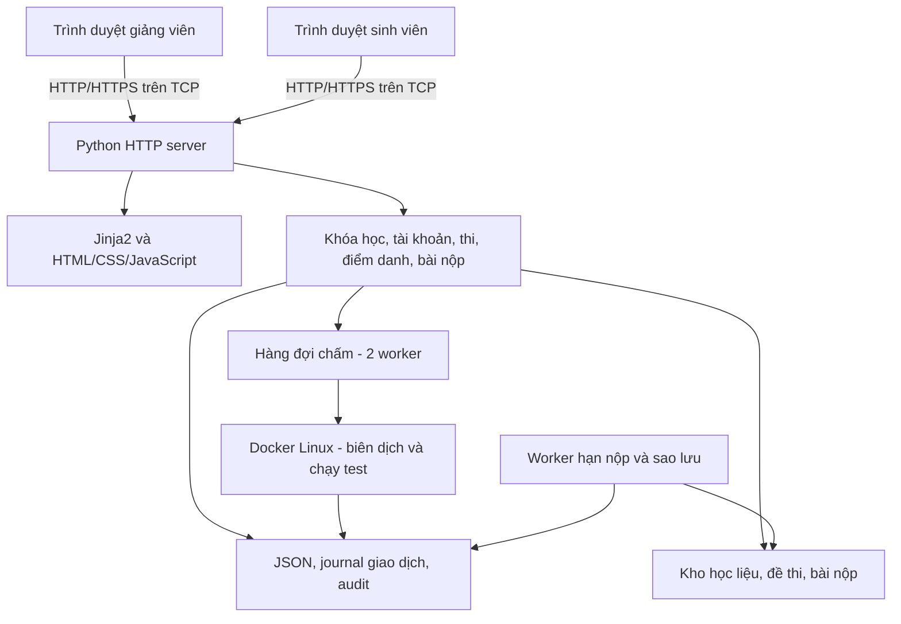
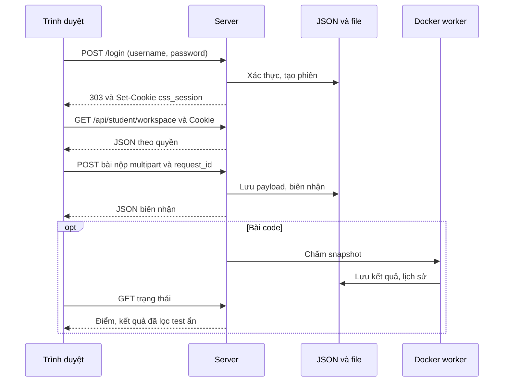

# LAN LMS — Hệ thống quản lý học tập và thi trong mạng LAN

LAN LMS (Classroom Submission Server) là hệ thống web dành cho lớp học/phòng máy: quản lý khóa học, học liệu, lịch học, điểm danh QR, bài tập, thi nộp file, chấm lập trình và bảng điểm. Giảng viên chạy server; sinh viên dùng trình duyệt trên cùng mạng LAN, không cần cài client.

Dự án thuộc học phần **Lập trình mạng**, năm học **2026–2027**. Backend xử lý HTTP trên TCP bằng thư viện chuẩn Python, lưu metadata JSON và chạy bài lập trình trong Docker.

## 1. Chức năng

Có hai vai trò: **Admin/giảng viên** và **Sinh viên**. Các admin có quyền quản trị chung; chưa phân quyền giảng viên theo từng khóa.

| Phân hệ | Admin/giảng viên | Sinh viên |
| --- | --- | --- |
| Tài khoản | Nhập danh sách, khóa/mở, reset mật khẩu, gỡ khóa đăng nhập tạm, tạo admin | Đăng nhập, xem hồ sơ, đổi mật khẩu |
| Khóa học | Tạo/sửa, quản lý thành viên, nhập/xuất gói khóa, tổng kết | Xem khóa được tham gia và đã tổng kết |
| Học liệu | Đăng tài liệu theo khóa/chủ đề | Xem trước, tải về |
| Lịch | Tạo buổi học, thông báo, lịch thi | Xem lịch tháng và hoạt động sắp tới |
| Bài tập | Giao bài, đính kèm đề, đặt hạn/số lượt, chấm và phản hồi | Nộp/nộp lại, xem phiên bản và nhận xét |
| Điểm danh | Mở phiên từ buổi học, hiển thị QR, điều chỉnh kết quả kèm lý do | Quét camera/ảnh QR, xem lịch sử |
| Thi nộp file | Phân phối đề, bắt đầu/kết thúc, gia hạn, ép thu bài | Nhận đề, xem giờ, nộp file |
| Thi lập trình | Tạo bài toán/test, mở thi, xem kết quả, chấm lại | Nộp C/C++/Java/Python, xem điểm |
| Giám sát | Theo dõi online, IP, trình duyệt, tab/cửa sổ và bài nộp | Cập nhật hiện diện khi dùng trang |
| Kho bài nộp | Tra cứu bài tập/file/code, lịch sử chấm, xuất CSV/ZIP | Xem/tải bài cá nhân còn lưu |
| Bảng điểm | Trọng số, điểm ghi đè, tổng kết | Xem thành phần và tổng kết |
| Thông báo | Gửi chung hoặc theo người nhận | Chuông, lọc, đánh dấu đọc |

## 2. Kiến trúc và công nghệ



| Thành phần | Công nghệ |
| --- | --- |
| Backend | Python; http.server, socket, ssl, threading, concurrent.futures |
| Template | Jinja2 >=3.1,<4, dependency trực tiếp duy nhất trong requirements.txt |
| Frontend | HTML, CSS, JavaScript thuần; Tailwind CSS 3.4.17 để build CSS |
| QR/icon | ZXing Browser 0.2.1 và Font Awesome trong static/vendor/ |
| Lưu trữ | JSON, payload file riêng, audit JSON Lines |
| Chấm code | Docker CLI; Debian Bookworm, GCC/G++, OpenJDK 17, Python 3 |
| Kiểm thử | Python unittest, Node.js, Chrome/Chromium/Edge qua CDP |

Không cần FastAPI, Uvicorn, Pydantic, database server hoặc Node.js để chạy web khi asset đầy đủ. Asset frontend phục vụ từ server, không cần CDN khi dùng trong LAN.

### Đồng thời và độ bền dữ liệu

- HTTP dùng thread theo kết nối, tối đa **128 worker**, backlog **128**; quá tải trả 503 và Retry-After.
- RLock bảo vệ trạng thái dùng chung. Các luồng tương ứng tách nhận body/gửi response khỏi khóa nghiệp vụ để hạn chế client chậm giữ khóa.
- JSON ghi qua file tạm, fsync và os.replace. Giao dịch nhiều cập nhật JSON/audit có journal để phục hồi thao tác gián đoạn; payload lưu trước metadata.
- OS lease ngăn server và CLI đã tích hợp cùng sửa một bộ dữ liệu. Mỗi bộ dữ liệu chỉ chạy **một tiến trình server**.
- Worker kiểm tra hạn khoảng mỗi giây, quét lại bài chờ chấm khoảng mỗi 10 giây. Hết hạn không phụ thuộc sinh viên giữ trang mở.

## 3. Yêu cầu và cài đặt

### Môi trường

- Python **3.10 trở lên** theo cú pháp/API sử dụng; dự án có dấu vết môi trường Python 3.13/3.14. Tạo lại virtual environment trên máy đích.
- Trình duyệt hiện đại có JavaScript, client kết nối được server qua LAN.
- Docker Engine/Desktop chạy **Linux containers** nếu dùng thi lập trình.
- Node.js/npm khi build CSS hoặc kiểm thử JavaScript. Browser QA cần Node.js có WebSocket toàn cục, chẳng hạn Node.js 22 trở lên.
- Đĩa đủ chứa image, học liệu, mọi phiên bản bài nộp và backup. Công cụ check cảnh báo dưới 512 MiB trống; đây không phải mức dung lượng khuyến nghị cho cả hệ thống.

### Windows: dùng script

Mở terminal tại thư mục gốc:

```powershell
.\setup_windows.bat
.\start_windows.bat
```

Setup tạo .venv và cài dependency. Start cấu hình admin qua console, chạy server nền rồi mở http://127.0.0.1:8080/login. Nhấn Enter để giữ tên/mật khẩu admin hiện có. Start cũng nhận .venv-windows nếu không có .venv\Scripts\python.exe.

Bước mở trình duyệt của script Windows dùng cố định HTTP cổng 8080. Khi đổi cổng hoặc bật HTTPS, chạy trực tiếp.

### Windows: chạy trực tiếp

```powershell
py -m venv .venv
.\.venv\Scripts\python.exe -m pip install -r requirements.txt
.\.venv\Scripts\python.exe -m app.setup_admin
.\.venv\Scripts\python.exe run_server.py
```

Chỉ chạy setup_admin khi cần tạo admin mới; không có mật khẩu admin mặc định được bảo đảm. Để giữ/cập nhật admin hiện có, dùng app.configure_admin khi server đã dừng.

### Linux/macOS

```bash
python3 -m venv .venv
.venv/bin/python -m pip install -r requirements.txt
.venv/bin/python -m app.setup_admin
bash start_unix.sh
```

Có thể chạy .venv/bin/python run_server.py trực tiếp. submission_server.py là entry point tương thích, gọi cùng backend. Giữ terminal chạy, nhấn Ctrl+C để dừng.

### Client và build giao diện

1. Xem LAN URL trong console hoặc mục **Địa chỉ LAN** phía admin.
2. Sinh viên mở http://<IP-server>:8080/login, ví dụ http://192.168.1.10:8080/login.
3. Cho phép cổng server trong firewall mạng phòng học; kiểm tra VPN/Wi-Fi isolation nếu không kết nối được.

127.0.0.1 trỏ tới máy đang mở trình duyệt; 0.0.0.0 là địa chỉ bind, không phải URL cho sinh viên.

Nếu thiếu hoặc thay đổi CSS:

```powershell
npm install
npm run build
```

Build biên dịch assets/tailwind.input.css thành static/css/tailwind.css. Không cần frontend development server riêng.

### Bộ chấm

```powershell
docker build -t classroom-judge:1 ./judge
```

Docker phải chạy trước khi mở thi code. Build cần mạng để tải image/package; lúc chấm dùng image có sẵn với --pull=never. LMS và thi file dùng được khi không có Docker, nhưng readiness tổng thể sẽ báo bộ chấm chưa sẵn sàng.

## 4. Cấu hình

Biến môi trường đọc khi khởi động; backend không tự nạp .env.

| Biến | Mặc định | Ý nghĩa |
| --- | --- | --- |
| CSS_HOST | 0.0.0.0 | Địa chỉ lắng nghe |
| CSS_PORT | 8080 | Cổng HTTP/HTTPS |
| CSS_DATA_ROOT | Gốc dự án | Gốc runtime, không đổi template/static |
| CSS_TLS_CERT / CSS_TLS_KEY | Không đặt | Chứng chỉ/khóa TLS, phải đặt cả hai |
| CSS_ALLOWED_ORIGINS | Không đặt | Origin bổ sung, phân cách dấu phẩy; mặc định so Origin với Host/scheme |
| CSS_REQUEST_IDLE_TIMEOUT | 30 giây | Timeout socket/chờ dữ liệu |
| CSS_REQUEST_BODY_TIMEOUT | 300 giây | Hạn tổng nhận body |
| CSS_JUDGE_IMAGE | classroom-judge:1 | Image chấm |
| CSS_JUDGE_TESTS | Không đặt | Đặt 1 để bật test Docker thật |
| CSS_TEST_PYTHON | Tự tìm venv | Python cho kiểm thử Node.js |
| CSS_TEST_CHROME | Tự tìm trình duyệt | File thực thi trình duyệt QA |

```powershell
$env:CSS_PORT = '8090'
.\.venv\Scripts\python.exe run_server.py
```

HTTPS với chứng chỉ đã chuẩn bị và được client tin cậy:

```powershell
$env:CSS_TLS_CERT = 'D:\certs\server.crt'
$env:CSS_TLS_KEY = 'D:\certs\server.key'
.\.venv\Scripts\python.exe run_server.py
```

Thời lượng, thí sinh, định dạng/số lượt nộp, mật khẩu đề và trọng số cấu hình qua admin. JSON nền được tạo khi cần; không cần SQL migration. Source có sẵn dữ liệu sẽ giữ dữ liệu hiện có.

## 5. Quy trình sử dụng

### Tài khoản và khóa học

1. Nhập sinh viên theo [student_accounts_template.txt](student_accounts_template.txt):

   ```text
   MSSV|Ngày sinh|Họ tên
   21010001|01/02/2003|Nguyen Van A
   21010002|15/08/2003|Tran Thi B
   ```

   Mỗi dòng đúng ba trường. Mật khẩu khởi tạo là **nguyên chuỗi ngày sinh** đã nhập. Tài khoản tồn tại được bỏ qua; dữ liệu sai báo theo dòng.
2. Tạo khóa, tên/mã/nhóm/học kỳ và thành viên. Hỗ trợ khóa toàn bộ sinh viên hoặc danh sách riêng.
3. Thêm học liệu, lịch và bài tập. Bài tập có hạn, tối đa 1–20 lượt theo cấu hình; giữ các phiên bản nộp.
4. Sinh viên dùng cửa sổ/hồ sơ trình duyệt khác admin để tránh ghi đè cookie giữa hai vai trò.
5. Giảng viên chấm/phản hồi; sinh viên xem điểm và lịch sử.

### Điểm danh QR

Tạo buổi học trong lịch rồi mở phiên từ buổi đó. Sinh viên vào **Điểm danh**, quét camera hoặc chọn ảnh QR. Backend kiểm tra thành viên, mã, hạn và trạng thái phiên. Quét lại không tạo trùng, không tự ghi đè quyết định Vắng của giảng viên.

HTTPS/localhost hỗ trợ camera video. HTTP trên IP LAN có thể bị hạn chế getUserMedia; có luồng chụp/chọn ảnh. Liên kết QR giữ qua bước đăng nhập để tiếp tục điểm danh.

### Thi nộp file

1. Đặt đề trong de-thi/ dưới gốc runtime: PDF, TXT, PNG, JPG/JPEG, GIF, WEBP.
2. Vào **Cấu hình kỳ thi**, chọn khóa, loại đánh giá (kiểm tra/giữa kỳ/cuối kỳ), thời lượng, thí sinh và chính sách nộp.
3. Phát đề rồi bắt đầu. Lưu được nhiều cấu hình, nhưng engine thi file chỉ chạy **một lượt phát đề tại một thời điểm**.
4. Sinh viên bắt đầu, nhập mật khẩu đề nếu bật, nhận đề và nộp đúng định dạng; mặc định ZIP.
5. Admin theo dõi, gia hạn cá nhân, ép thu bài hoặc kết thúc để chặn nộp mới.

| Chế độ | Phân phối |
| --- | --- |
| random | Nhóm subnet IPv4 /24 hoặc IPv6 /64, sắp IP, luân phiên bộ đề đã xáo trộn |
| selected | Luân phiên danh sách chọn sau khi xáo trộn thứ tự đề |
| parity | Theo chữ số cuối tìm được trong MSSV: chẵn/lẻ |
| custom | Ánh xạ chữ số cuối MSSV tới đề theo cấu hình số dư |

IP không chứng minh chỗ ngồi. Hạn do server xác định theo mốc chung và điều chỉnh cá nhân; vào muộn không mặc nhiên được đủ thời lượng mới. Worker tự đóng khi hết hạn. Ép thu bài ngăn nộp tiếp, không lấy file chưa gửi trên máy sinh viên.

### Thi lập trình

1. Tạo **Thi lập trình**, thêm bài toán, điểm, ngôn ngữ, giới hạn chạy, test mẫu/ẩn.
2. Nhập test trực tiếp hoặc CSV input,output,sample; xem [file mẫu](static/samples/test-cases.csv). Ô nhiều dòng đặt trong nháy kép; chuỗi `\n` không tự thành xuống dòng.
3. Mỗi bài phải có test. Cấu hình/test khóa sau khi mở; thí sinh lấy từ thành viên đang hoạt động.
4. Sinh viên bắt đầu, chọn bài/ngôn ngữ, nộp một file UTF-8: .c, .cpp, .java, .py. Java dùng public class Main, không package.
5. Lưu nguồn gốc, snapshot đề/test và image ID, trả biên nhận rồi chấm nền. Chấm lại dùng snapshot đã lưu, giữ lịch sử trước.

Chương trình đọc stdin, ghi đáp án stdout, không in lời nhắc. Biên dịch một lần trong container riêng; mỗi test chạy container mới: tắt mạng, user không root, drop capabilities, filesystem gốc chỉ đọc, giới hạn CPU/RAM/process/output. Container chỉ nhận input hiện tại; output mong đợi ở server.

- Checker tokens bỏ khác biệt khoảng trắng giữa token; checker chính xác chuẩn hóa CRLF thành LF nhưng giữ khoảng trắng và xuống dòng cuối.
- Điểm bài = điểm tối đa × số test AC / tổng test. Test mẫu và ẩn cùng trọng số.
- Verdict: AC, WA, CE, RE, TLE, MLE, OLE. Lỗi hạ tầng SYSTEM_ERROR có điểm chưa xác định.
- Sinh viên chỉ xem input/output/stderr test mẫu; test ẩn được lọc cả lịch sử.
- Hai worker chấm đồng thời. Khi nhận bài mới kiểm tra tối đa 50 bài chờ/đang chấm và hai bài mỗi sinh viên.
- Bài queued/running được xếp lại khi khởi động. Đóng thi vẫn chấm bài đã nhận.

Xem [programming-judge.md](docs/programming-judge.md). Mô tả cũ về thời lượng/điểm trong tài liệu phụ có chỗ chưa phản ánh backend hiện tại; README dùng quy tắc hạn chung và bảng điểm theo mã nguồn.

### Bảng điểm

Mặc định **chuyên cần 10% + bài tập 10% + giữa kỳ 10% + cuối kỳ 70%**. Đổi được trọng số, tổng phải 100%.

- Chuyên cần từ 10, trừ một mỗi phiên đóng/hết hạn mà sinh viên không Có mặt/Muộn, tối thiểu 0.
- Bài tập lấy điểm lần nộp mới nhất mỗi bài; quá hạn chưa nộp tính 0. Chưa chấm thì chưa có điểm.
- Kỳ thi midterm/final tự tham gia thành phần; loại test không tham gia. Thi file lấy điểm lần nộp mới nhất; code lấy điểm tốt nhất từng bài rồi quy về thang 10. Nhiều kỳ thi cùng thành phần lấy trung bình khi đủ điểm.
- Điểm nhập tay ghi đè tự tính; xóa giá trị ghi đè để dùng lại tự tính.
- Chỉ có tổng khi đủ thành phần có trọng số lớn hơn 0. Thi còn phát/mở hoặc thiếu điểm thì không tổng kết được.
- Khóa tổng kết vẫn xem được, chặn sửa/nộp thuộc khóa.

### Dữ liệu trình diễn

Dừng server trước khi chạy CLI. Thêm demo, không thay toàn bộ dữ liệu:

```powershell
.\.venv\Scripts\python.exe -m app.seed_demo --apply
```

Thêm DEMO001–DEMO020, mật khẩu ban đầu **111111**, ba khóa, học liệu, lịch, bài tập, điểm danh, thông báo. Có backup và marker tránh trùng, không đổi mật khẩu tài khoản cũ. Xem [DEMO_TEST_GUIDE.md](docs/DEMO_TEST_GUIDE.md).

Thêm ba kỳ thi code thử, cần Docker/image:

```powershell
.\.venv\Scripts\python.exe -m app.programming_trial --apply
.\.venv\Scripts\python.exe run_server.py
```

Tài khoản CHAMTHU01, mật khẩu khởi tạo **ThiThu2026!**. Thêm --draft để tạo nháp khi chưa có bộ chấm. start_trial_exams.bat là lối tắt tạo/mở bộ thử rồi chạy web.

app.reset_demo là công cụ **thay bộ dữ liệu**: --prepare tạo staging, --apply <staging> đưa mẫu vào và chuyển dữ liệu cũ sang backup. Bộ này dùng SV001–SV020, mật khẩu mẫu 111111. Không thuộc cài đặt thông thường; nên dùng bản sao riêng để trình diễn. Mật khẩu mẫu không bảo đảm còn đúng sau khi tài khoản đổi mật khẩu.

## 6. Giao tiếp mạng và API

Dùng **HTTP/1.1 trên TCP**, tùy chọn TLS/HTTPS. Giao diện cập nhật bằng request/polling, không WebSocket/SSE. Backend parse URL-encoded/multipart bằng thư viện chuẩn, trả HTML/JSON/file cùng Content-Length.



Ví dụ sau đăng nhập:

```http
POST /api/student/start HTTP/1.1
Host: 192.168.1.10:8080
Origin: http://192.168.1.10:8080
Cookie: css_session=<session-token>
Content-Type: application/x-www-form-urlencoded
Content-Length: 14

exam_password=
```

Thành công trả ok, exam_file, started_at, ends_at, remaining_seconds. Lỗi API dạng `{"detail":"Nội dung lỗi"}`. API ghi chủ yếu nhận **form/multipart**, không JSON body trực tiếp; một số trường form phức tạp chứa chuỗi JSON.

| Method | Endpoint chính | Mục đích |
| --- | --- | --- |
| GET | /health | Liveness công khai |
| POST | /login, /logout | Tạo/hủy phiên |
| GET | /api/learning, /api/student/workspace | Snapshot học tập |
| POST | /api/learning/{action} | Khóa, học liệu, lịch, bài tập, điểm danh, điểm |
| GET | /api/learning/files/{kind}/{id} | Tải file theo quyền |
| GET | /api/learning/preview/{kind}/{id}, /api/learning/view/{kind}/{id} | Xem trước/PDF |
| GET/POST tương ứng | /api/learning/export-course, /api/learning/import-course | Chuyển gói khóa JSON |
| GET | /api/admin/workspace, /api/admin/monitor | Dashboard/giám sát |
| GET | /api/admin/accounts, /api/admin/exams, /api/admin/server-info | Tài khoản, đề, địa chỉ |
| POST | /api/admin/accounts/import | Nhập sinh viên |
| POST | /api/admin/exam-configurations/save, /api/admin/exam-configurations/activate | Lưu/kích hoạt thi |
| POST | /api/admin/distribute, /api/admin/start-exam, /api/admin/end-exam | Điều khiển thi file |
| GET | /api/student/exam | Tải đề |
| POST | /api/student/start, /api/student/submit | Bắt đầu/nộp file |
| POST | /api/student/programming/start, /api/student/programming/submit | Bắt đầu/nộp code |
| GET | /api/student/programming/submissions | Code cá nhân |
| POST | /api/admin/programming/control, /api/admin/programming/rejudge | Mở/đóng/chấm lại |
| GET | /api/admin/archive/... | Tra cứu/tải/xuất kho bài |
| POST | /api/admin/archive/grade | Chấm từ kho |
| GET/POST tương ứng | /api/student/notifications, /api/student/notifications/read | Xem/đánh dấu đọc |
| POST | /api/student/change-password, /api/student/telemetry | Mật khẩu/hiện diện |
| GET | /api/admin/readiness | Kiểm tra dữ liệu/file/đĩa/CSS/bộ chấm, cần admin |

Chi tiết route và trường form: [main.py](app/main.py), [learning.py](app/learning.py) và module nghiệp vụ.

### Xác thực, đầu vào và lỗi

- Mật khẩu scrypt có salt; cookie HttpOnly, SameSite=Strict, TTL 12 giờ, Secure khi TLS. Token lưu dạng SHA-256.
- Ba lần sai trong cửa sổ kiểm soát khóa tạm 15 phút; khóa tài khoản do admin là trạng thái riêng. Có quota nguồn đăng nhập, giới hạn băm đồng thời.
- Backend kiểm tra vai trò/thành viên/chủ bài; đổi/reset mật khẩu thu hồi phiên sinh viên.
- Kiểm tra Origin khi có header; Jinja2 autoescape, CSP hạn chế tài nguyên ngoài origin. HTTP mặc định chưa mã hóa.
- Từ chối Content-Length sai/trùng/quá lớn và Transfer-Encoding chưa hỗ trợ; timeout cho body chậm/thiếu.
- ZIP kiểm tra chữ ký/CRC/đường dẫn/giới hạn giải nén. Xem trước không chạy code/HTML tải lên.
- Retry cùng request_id/nội dung trả biên nhận cũ; khác nội dung bị từ chối. Quota chung sáu lượt nộp thành công/60 giây/sinh viên.
- Lỗi: 400 dữ liệu sai, 401 chưa đăng nhập, 403 thiếu quyền/Origin, 404 thiếu tài nguyên, 408 timeout, 409 xung đột trạng thái/retry, 413 dung lượng, 429 quota/queue, 503 quá tải/bộ chấm.

| Đối tượng | Giới hạn |
| --- | --- |
| Request body | 50 MiB gồm multipart; file thi phải chừa overhead form |
| Học liệu/file bài tập | 20 MiB/file; định dạng theo learning.EXTENSIONS |
| ZIP | 3.000 mục, tổng dung lượng khai báo giải nén 250 MiB |
| Xem trước | Văn bản 2 MiB; ZIP chỉ liệt kê, DOCX/PPTX trích chữ |
| Gói khóa | File nhúng tổng 15 MiB, JSON nhập 24 MiB |
| Mã nguồn | 1–100.000 byte UTF-8 |
| Test | Tối đa 100/bài, còn phải thỏa ngân sách khi lưu/mở |
| Lượt chấm | Ngân sách tổng 300 giây theo code_runner.MAX_JOB_SECONDS |
| Output/test | stdout 1 MiB, stderr 64 KiB; phần lưu xem bị cắt ngắn |

## 7. Cấu trúc và lưu trữ

```text
LMS_LAN/
├── run_server.py                 # Entry point chính
├── submission_server.py          # Entry point tương thích
├── setup_windows.bat             # Cài môi trường
├── start_windows.bat             # Cấu hình admin, chạy web
├── start_unix.sh                 # Chạy Linux/macOS
├── start_trial_exams.bat          # Bộ thi thử code
├── app/                         # Backend và CLI
├── templates/                   # HTML Jinja2
├── assets/                      # Đầu vào Tailwind
├── static/                      # CSS, JS, vendor, CSV mẫu
├── judge/Dockerfile             # Image bộ chấm
├── tests/                       # Unit, HTTP, browser, benchmark
├── docs/                        # Hướng dẫn, audit, report.docx
├── data/                        # Metadata JSON
├── de-thi/                      # Đề thi
├── learning-files/              # Học liệu, đề và bài nộp bài tập
├── submissions/                 # Bài thi file
├── programming-submissions/     # Nguồn và snapshot đề/test
├── judge-work/                  # Chấm tạm
├── logs/                        # Audit, kết quả đo
├── backups/                     # Sao lưu
└── previews/                    # Ảnh/kết quả QA
```

| Module app/ | Trách nhiệm |
| --- | --- |
| main, http, config, runtime | Routing, form, response, cấu hình, worker, lease |
| security, accounts, setup_admin, configure_admin | Xác thực, nhập tài khoản, bootstrap admin |
| storage | JSON, cache, khóa, giao dịch, journal, audit |
| learning, course_grades, course_packages | LMS, điểm danh, bảng điểm, chuyển khóa |
| exams, exam_catalog, admin_workspace | Phát đề, cấu hình thi, quản trị |
| submissions, submission_rate, submission_archive | Nhận bài, quota, kho bài |
| programming, code_runner | Queue, snapshot, Docker, chấm lại |
| deadlines, maintenance | Đóng hạn, kiểm tra môi trường, backup, phục hồi |
| notifications | Feed và trạng thái đọc cá nhân |
| seed_demo, programming_trial, reset_demo | Dữ liệu/kỳ thi trình diễn |

| File dữ liệu trong data/ | Nội dung |
| --- | --- |
| students.json, admins.json | Hồ sơ, hash mật khẩu, trạng thái |
| sessions.json, login_attempts.json, auth_throttle.json | Phiên/kiểm soát đăng nhập |
| learning.json | Courses, materials, events, assignments, submissions, attendance, grades |
| settings.json, assignments.json | Thi file hiện hành, đề/hạn theo sinh viên |
| exam_catalog.json | Cấu hình thi file/code |
| submissions.json | Biên nhận/lịch sử thi file |
| programming_submissions.json, programming_attempts.json | Code, lịch sử chấm, phiên làm bài |
| submission_rate.json | Tần suất nộp |
| notifications.json, notification_reads.json | Thông báo và trạng thái đọc |

Audit ghi ở logs/audit.jsonl. Liên kết qua course_id, assignment_id, exam_id, student_id, release_id. Không sửa JSON trực tiếp khi server chạy. Gói xuất khóa tái sử dụng nội dung, không thay backup tài khoản, điểm và bài nộp.

## 8. Kiểm thử và kết quả

```powershell
# Backend; Docker thật mặc định bỏ qua
.\.venv\Scripts\python.exe -m unittest discover -s tests -p 'test_*.py' -v

# Cú pháp JS, helper UI và unittest Python
$env:CSS_TEST_PYTHON = (Resolve-Path '.\.venv\Scripts\python.exe').Path
npm test

# Browser QA headless
npm run test:browser

# Bật Docker thật khi image sẵn sàng
$env:CSS_JUDGE_TESTS = '1'
npm test
```

Browser QA không thay toàn bộ unittest. Đặt CSS_TEST_CHROME nếu không tìm thấy trình duyệt. Linux/macOS dùng đường dẫn Python/cú pháp biến môi trường tương ứng.

Test bao phủ tài khoản/Origin/ZIP, LMS, thi/điểm, HTTP/body chậm, retry, lỗi ghi/giao dịch, queue, Docker, CSV, QR, phân quyền, mobile và lỗi JavaScript/CSP. Test nghiệp vụ/browser dùng dữ liệu tạm.

### Bằng chứng có sẵn

Đây là artifact đã lưu, **không phải kết quả chạy mới khi viết README**:

- [backend-final-checks.log](logs/backend-final-checks.log): **114 test Python**, kết thúc OK, **87,930 giây**.
- [backend-final-browser.log](logs/backend-final-browser.log): ghi nhận đạt các luồng giao diện, mobile HTTP login, QR qua đăng nhập, mật khẩu, bài tập/điểm, JavaScript/CSP.
- [backend-load.json](logs/backend-load.json): **30 sinh viên**, **900 bài lịch sử**, **30 request đồng thời mỗi pha**, loopback, Docker không bận chấm.

| Pha | Request | Lỗi | Trung vị (ms) | P95 (ms) | Cao nhất (ms) |
| --- | ---: | ---: | ---: | ---: | ---: |
| Workspace | 30 | 0 | 177,8 | 243,8 | 244,3 |
| Nhận bài tập | 30 | 0 | 515,7 | 854,5 | 877,6 |

Tạo đúng **30 biên nhận mới**. Tái lập:

```powershell
.\.venv\Scripts\python.exe tests/benchmark_classroom.py --students 30
```

Benchmark dùng dữ liệu tạm, ghi đè logs/backend-load.json. Loopback/file nhỏ không đại diện upload lớn Wi-Fi hoặc Docker đầy tải. Artifact chưa đủ thông tin phần cứng để suy ra sức chứa mọi phòng máy.

### Đóng góp kỹ thuật

So với phạm vi phát đề/nhận file ban đầu:

| Đóng góp | Bằng chứng mã nguồn |
| --- | --- |
| LMS cùng tài khoản và phân quyền khóa | learning.py, course_grades.py, workspace |
| Phân phối đề xét subnet/IP | exams.distribute_exams |
| Chấm bất đồng bộ, giới hạn tài nguyên, lọc test ẩn | programming.py, code_runner.py |
| Phiên bản bài, snapshot đề/image, lịch sử chấm | submissions.py, submission_archive.py, programming.py |
| Retry chống trùng, journal giao dịch | storage.py, các luồng request_id |
| Hạn độc lập trình duyệt, backup kiểm chứng | deadlines.py, maintenance.py |

Chưa có đối chứng đủ để kết luận mức tăng hiệu năng so với baseline.

## 9. Sao lưu và phục hồi

Tự backup khoảng 30 giây sau khởi động, sau đó mỗi sáu giờ, giữ bảy bản auto- mới nhất. Backup gồm metadata, học liệu, bài thi file/code và đề, kèm manifest SHA-256/kiểm tra tham chiếu. Không gồm toàn bộ logs/; lưu riêng audit nếu cần.

Dừng server trước CLI check/backup để lấy lease:

```powershell
.\.venv\Scripts\python.exe -m app.maintenance check
.\.venv\Scripts\python.exe -m app.maintenance check --execute
.\.venv\Scripts\python.exe -m app.maintenance backup
```

--execute chấm thêm Python mẫu. Khi web chạy, admin dùng /api/admin/readiness; /health chỉ là liveness.

Thay đường dẫn mẫu bằng backup thật, phục hồi vào thư mục mới/rỗng:

```powershell
.\.venv\Scripts\python.exe -m app.maintenance verify '.\backups\manual-<timestamp>-<id>'
.\.venv\Scripts\python.exe -m app.maintenance restore-copy '.\backups\manual-<timestamp>-<id>' --target '.\restore-drill'
$env:CSS_DATA_ROOT = (Resolve-Path '.\restore-drill').Path
$env:CSS_PORT = '8091'
.\.venv\Scripts\python.exe run_server.py
```

Phục hồi xóa session/throttle nguồn cũ. Backup demo cũ có thể thiếu manifest nên không mặc nhiên dùng được với maintenance verify. Kiểm tra đủ tài khoản/file/bài/điểm trước khi chuyển bộ dữ liệu.

## 10. Xử lý sự cố

| Hiện tượng | Kiểm tra |
| --- | --- |
| Thiếu Jinja2 | Cài requirements bằng đúng Python chạy server |
| Venv lỗi trên máy khác | Tạo lại, không sao chép venv khác hệ điều hành |
| Cổng bận | Dừng server cũ hoặc đổi CSS_PORT |
| Dữ liệu đang dùng | Dừng tiến trình giữ dữ liệu, không xóa lock để vượt lease |
| Client không truy cập | IP LAN, firewall, cổng, VPN, Wi-Fi isolation |
| Khóa đăng nhập | Chờ 15 phút hoặc gỡ khóa tạm; kiểm tra riêng khóa tài khoản |
| Origin sai | Mở đúng URL, kiểm tra Host/scheme/proxy |
| Không nhận đề | de-thi, thành viên/thí sinh, trạng thái, mật khẩu đề |
| Camera HTTP LAN lỗi | Chụp/chọn ảnh hoặc HTTPS được tin cậy |
| Không chấm code | Docker Linux, image, dung lượng, readiness |
| Chưa có tổng điểm | Bài chưa chấm, trọng số, loại đánh giá, thành phần |
| Thiếu CSS/icon/QR | Kiểm tra static/vendor, build CSS nếu cần |

## 11. Giới hạn và hướng phát triển

- JSON/khóa trong tiến trình phù hợp một server; chưa hỗ trợ nhiều server cùng ghi. Chương trình ngoài bỏ qua lease có thể phá nhất quán.
- Giới hạn worker/queue là rào chắn tài nguyên, không cam kết sức chứa 128 sinh viên dưới mọi tải.
- HTTP mặc định không mã hóa; public deployment cần TLS, proxy và giám sát theo môi trường.
- Telemetry có thể bị can thiệp, QR có thể chia sẻ; không bảo đảm chống gian lận hoặc xác minh hiện diện vật lý.
- Chưa có SSO, quyền giảng viên riêng theo khóa, checker số thực/tùy biến, bài code nhiều file.
- Chính sách mật khẩu import/tự đổi/reset chưa đồng nhất; import chưa bắt buộc đổi lần đầu.
- Giữ mọi phiên bản/backup tăng dung lượng; kiểm thử phục hồi không thay thử mất điện thật trên mọi filesystem.

Hướng phát triển: database có giao dịch, worker chấm riêng, phân quyền giảng viên, thống nhất vòng đời tài khoản, benchmark LAN kết hợp Docker, tự động hóa đóng gói/kiểm thử.

## 12. Tài liệu và giấy phép

- [SPECIFICATION.md](SPECIFICATION.md): đặc tả; đối chiếu backend khi khác biệt.
- [student-workspace.md](docs/student-workspace.md): giao diện/quy trình LMS.
- [programming-judge.md](docs/programming-judge.md): bộ chấm.
- [DEMO_TEST_GUIDE.md](docs/DEMO_TEST_GUIDE.md): demo bổ sung.
- [BACKEND_HARDENING_2026-10-29.md](docs/BACKEND_HARDENING_2026-10-29.md): giao dịch/retry/bảo trì và kiểm chứng.
- [REQUEST_IO_FIX_2026-10-29.md](docs/REQUEST_IO_FIX_2026-10-29.md), [FULL_PROJECT_AUDIT_2026-10-29.md](docs/FULL_PROJECT_AUDIT_2026-10-29.md), [PROJECT_REVIEW_2026-10-29.md](docs/PROJECT_REVIEW_2026-10-29.md): ghi nhận kiểm tra tại thời điểm tương ứng.
- [report.docx](docs/report.docx): báo cáo hiện có.
- [Instruction.md](Instruction.md), [Topics.md](Topics.md), [Submission.md](Submission.md): hướng dẫn học phần.
- [ZXing NOTICE](static/vendor/zxing/NOTICE.txt), các LICENSE cùng thư mục và [Font Awesome LICENSE](static/vendor/fontawesome/LICENSE.txt).

Tên thành viên, MSSV, giảng viên và tỷ lệ đóng góp chưa xác định trong README mẫu ban đầu; cần bổ sung theo thông tin thật của nhóm khi hoàn thiện hồ sơ học phần.
