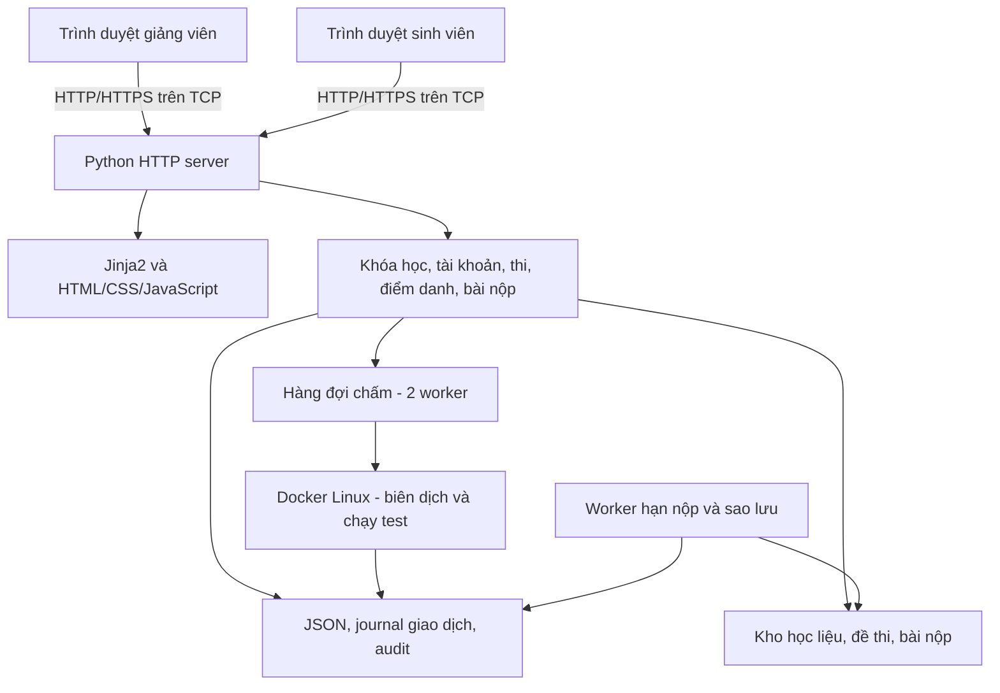
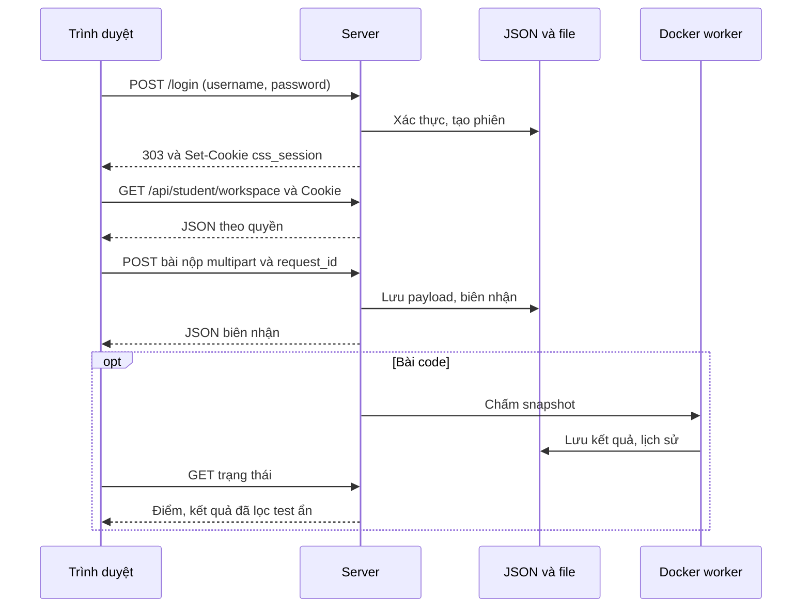

# NETWORK PROGRAMMING – FINAL PROJECT

**LAN LMS — Hệ thống quản lý học tập và thi trong mạng LAN**

**Năm học 2026–2027 · Nhóm 15 · Lớp 10**

## Mục lục

1. [Project Information](#1-project-information)
2. [Project Summary](#2-project-summary)
3. [System Overview](#3-system-overview)
4. [System Architecture](#4-system-architecture)
5. [Network Communication Design](#5-network-communication-design)
6. [Technology Stack](#6-technology-stack)
7. [Novelty and Contributions](#7-novelty-and-contributions)
8. [Project Structure](#8-project-structure)
9. [Requirements](#9-requirements)
10. [Installation](#10-installation)
11. [Running the Project](#11-running-the-project)
12. [Main Features](#12-main-features)
13. [Experimental Setup](#13-experimental-setup)
14. [Experimental Results](#14-experimental-results)
15. [Discussion](#15-discussion)
16. [Limitations](#16-limitations)
17. [Future Work](#17-future-work)
18. [Report](#18-report)
19. [References](#19-references)
20. [Team Contribution](#20-team-contribution)
21. [Demo](#21-demo)
22. [Submission](#22-submission)
23. [Final Verification](#23-final-verification)
24. [Contact](#24-contact)

---

# 1. Project Information

## 1.1. Project Name

**LAN LMS (Classroom Submission Server)** — Hệ thống quản lý học tập và thi trong mạng LAN.

## 1.2. Topic

**Chủ đề 3 – Ứng dụng mạng**, định hướng hệ thống thi qua mạng và Networked Auto-Grader trong danh mục chủ đề học phần. Tên đề tài theo báo cáo: **Thiết kế và xây dựng hệ thống LMS và thi code trên mạng LAN theo mô hình Client–Server**.

## 1.3. Group

Học viện Công nghệ Bưu chính Viễn thông, Khoa Công nghệ thông tin 1; học phần Lập trình mạng; lớp 10; nhóm 15. Thông tin tên, MSSV và phân công lấy từ bìa/phụ lục C của báo cáo.

| STT | MSSV | Họ tên | Email | Trách nhiệm chính | Đóng góp |
| --- | --- | --- | --- | --- | ---: |
| 1 | B23DCCN699 | Nguyễn Thừa Văn Quý | nguyenthuavanquy@gmail.com | Phân tích yêu cầu, kiến trúc; HTTP server, xác thực, tài khoản, phân quyền và bảo mật. | 25% |
| 2 | B23DCCN265 | Nguyễn Vũ Song Hà | vusonghoang.nguyen@gmail.com | Khóa học, tài liệu, bài tập, điểm danh QR, bảng điểm và giao diện học tập. | 25% |
| 3 | B23DCCN776 | Nguyễn Thu Thảo | thuthao205205@gmail.com | Kỳ thi, phân phối đề, thời gian thi, nộp file, thi code và chấm Docker. | 25% |
| 4 | B23DCCN081 | Nguyễn Thị Bích | nguyenbich01686@gmail.com | Lưu trữ/phục hồi, đồng thời, chống nộp trùng, giám sát, kiểm thử và tổng hợp báo cáo. | 25% |
| | | | | **Tổng** | **100%** |

## 1.4. Instructor

**Ngô Văn Quyền**.

---

# 2. Project Summary

## 2.1. Problem

Trong lớp học thực hành, giảng viên cần phát tài liệu, giao bài, điểm danh và tổ chức thi cho nhiều sinh viên cùng truy cập. Sử dụng nhiều công cụ rời rạc gây khó theo dõi tiến độ và đối chiếu kết quả. Máy chủ còn phải xử lý nộp đồng thời, gửi lại do mất kết nối và lỗi chấm mà không làm mất hoặc ghi trùng bài.

## 2.2. Motivation

Theo chương 1 và 3 của báo cáo, LAN LMS tập trung các hoạt động này vào một hệ thống web trong phòng máy. Sinh viên chỉ cần trình duyệt; giảng viên vận hành một server trong LAN, không cần cài client riêng hoặc triển khai dịch vụ Internet cho mỗi lớp.

## 2.3. Objectives

1. Quản lý tài khoản, khóa học, học liệu, lịch, bài tập, điểm danh và bảng điểm thống nhất.
2. Tổ chức thi file và thi code với quyền truy cập và thời gian do server quyết định.
3. Chấm C/C++/Java/Python trong Docker với giới hạn tài nguyên và bảo vệ test ẩn.
4. Tiếp nhận nhiều kết nối, chống bài nộp trùng và duy trì tính nhất quán khi cập nhật dữ liệu.
5. Kiểm thử nghiệp vụ, giao tiếp mạng, phục hồi và đo thời gian phản hồi bằng kịch bản tái lập.

## 2.4. Scope

### In scope

- Một server cho lớp học/phòng máy trong LAN; client là trình duyệt máy tính hoặc di động.
- Hai vai trò admin/giảng viên và sinh viên; quản lý nhiều khóa học.
- LMS, điểm danh QR, thi file, thi code, giám sát, thông báo, lịch sử và xuất dữ liệu.
- Lưu trữ JSON/JSONL và payload file, sao lưu/kiểm chứng/phục hồi.

### Out of scope

- Nhiều server cùng ghi một bộ dữ liệu; cân bằng tải và triển khai Internet quy mô lớn.
- SSO, quyền giảng viên riêng theo khóa, chống gian lận bằng giám sát màn hình.
- Bài code nhiều file, checker tùy biến/số thực và ngôn ngữ ngoài bốn ngôn ngữ đã hỗ trợ.
- Khẳng định sức chứa mọi phòng máy hoặc hiệu năng tốt hơn hệ thống khác khi chưa có phép đo đối chứng.

---

# 3. System Overview

## 3.1. System Description

LAN LMS (Classroom Submission Server) là hệ thống web dành cho lớp học/phòng máy: quản lý khóa học, học liệu, lịch học, điểm danh QR, bài tập, thi nộp file, chấm lập trình và bảng điểm. Giảng viên chạy server; sinh viên dùng trình duyệt trên cùng mạng LAN, không cần cài client.

## 3.2. Target Users

- **Admin/giảng viên:** tổ chức lớp, quản trị tài khoản, cấu hình thi, theo dõi và đánh giá kết quả. Các admin có quyền quản trị chung.
- **Sinh viên:** truy cập khóa được tham gia, đọc học liệu, điểm danh, nộp bài, thi và xem kết quả cá nhân.

## 3.3. Main Functions

Có hai vai trò: **Admin/giảng viên** và **Sinh viên**. Các admin có quyền quản trị chung; chưa phân quyền giảng viên theo từng khóa.

| Phân hệ | Admin/giảng viên | Sinh viên |
| --- | --- | --- |
| Tài khoản | Nhập danh sách, khóa/mở, reset mật khẩu, gỡ khóa đăng nhập tạm, tạo admin | Đăng nhập, xem hồ sơ, đổi mật khẩu |
| Khóa học | Tạo/sửa, quản lý thành viên, nhập/xuất gói khóa, tổng kết | Xem khóa được tham gia và đã tổng kết |
| Học liệu | Đăng tài liệu theo khóa/chủ đề | Xem trước, tải về |
| Lịch | Tạo buổi học, thông báo, lịch thi | Xem lịch tháng và hoạt động sắp tới |
| Bài tập | Giao bài, đính kèm đề, đặt hạn/số lượt, chấm và phản hồi | Nộp/nộp lại, xem phiên bản và nhận xét |
| Điểm danh | Mở phiên từ buổi học, hiển thị QR, điều chỉnh kết quả kèm lý do | Quét camera/ảnh QR, xem lịch sử |
| Thi nộp file | Phân phối đề, bắt đầu/kết thúc, gia hạn, ép thu bài | Nhận đề, xem giờ, nộp file |
| Thi lập trình | Tạo bài toán/test, mở thi, xem kết quả, chấm lại | Nộp C/C++/Java/Python, xem điểm |
| Giám sát | Theo dõi online, IP, trình duyệt, tab/cửa sổ và bài nộp | Cập nhật hiện diện khi dùng trang |
| Kho bài nộp | Tra cứu bài tập/file/code, lịch sử chấm, xuất CSV/ZIP | Xem/tải bài cá nhân còn lưu |
| Bảng điểm | Trọng số, điểm ghi đè, tổng kết | Xem thành phần và tổng kết |
| Thông báo | Gửi chung hoặc theo người nhận | Chuông, lọc, đánh dấu đọc |

Các phân hệ trên đã có triển khai trong source; trạng thái kiểm chứng được phân biệt ở mục 12 và 14.

---

# 4. System Architecture

## 4.1. Architecture Diagram



Sơ đồ được nhúng bằng Mermaid để không phụ thuộc ảnh ngoài repo; GitHub hỗ trợ hiển thị trực tiếp. Nếu nộp ảnh theo khung học phần, xuất sơ đồ thành `statics/architecture.png`.

## 4.2. Components

| Thành phần | Trách nhiệm |
| --- | --- |
| Client trình duyệt | Hiển thị HTML/CSS, gửi fetch/form, quét QR và cập nhật trạng thái |
| HTTP server | Nhận kết nối, phân tích request, xác thực và trả HTML/JSON/file |
| Dịch vụ nghiệp vụ | Tài khoản, LMS, thi, điểm danh, thông báo, bảng điểm |
| Kho JSON và file | Metadata, payload, phiên bản, journal và audit; không có database server riêng |
| Worker hạn/lịch | Tự mở thi đủ cấu hình theo lịch và đóng nhận bài khi hết hạn |
| Worker chấm | Hai worker nền gửi mã nguồn vào Docker, lưu kết quả/lịch sử |
| Worker bảo trì | Sao lưu định kỳ, manifest và kiểm tra dữ liệu |

## 4.3. Data Flow

Client gửi yêu cầu → server kiểm tra phiên/quyền/đầu vào → nghiệp vụ đọc hoặc cập nhật JSON và payload → server trả kết quả. Với code, biên nhận được lưu trước rồi worker chấm snapshot; client polling để nhận verdict. Các luồng ghi được đồng bộ trong một tiến trình, payload được lưu trước metadata tham chiếu tới nó.

- HTTP dùng thread theo kết nối, tối đa **128 worker**, backlog **128**; quá tải trả 503 và Retry-After.
- RLock bảo vệ trạng thái dùng chung. Các luồng tương ứng tách nhận body/gửi response khỏi khóa nghiệp vụ để hạn chế client chậm giữ khóa.
- JSON ghi qua file tạm, fsync và os.replace. Giao dịch nhiều cập nhật JSON/audit có journal để phục hồi thao tác gián đoạn; payload lưu trước metadata.
- OS lease ngăn server và CLI đã tích hợp cùng sửa một bộ dữ liệu. Mỗi bộ dữ liệu chỉ chạy **một tiến trình server**.
- Worker kiểm tra hạn khoảng mỗi giây, quét lại bài chờ chấm khoảng mỗi 10 giây. Hết hạn không phụ thuộc sinh viên giữ trang mở.

---

# 5. Network Communication Design

## 5.1. Communication Model

Mô hình client–server, request/response. Một server lắng nghe trên IP/cổng của máy giảng viên; nhiều trình duyệt kết nối TCP. Mỗi HTTP connection được xử lý theo cơ chế đa luồng có giới hạn.

## 5.2. Protocol

**HTTP/1.1 trên TCP/IP; tùy chọn HTTPS/TLS.** Frontend cập nhật bằng polling, không dùng WebSocket/SSE. Giữ kết nối HTTP theo quy tắc giao thức; đóng kết nối khi request bị từ chối hoặc có lỗi body cần tránh nhầm với request tiếp theo.

## 5.3. Message Format

```http
POST /api/student/start HTTP/1.1
Host: 192.168.1.10:8080
Origin: http://192.168.1.10:8080
Cookie: css_session=<session-token>
Content-Type: application/x-www-form-urlencoded
Content-Length: 14

exam_password=
```

Thành công trả ok, exam_file, started_at, ends_at, remaining_seconds. Lỗi API dạng `{"detail":"Nội dung lỗi"}`. API ghi chủ yếu nhận **form/multipart**, không JSON body trực tiếp; một số trường form phức tạp chứa chuỗi JSON.

## 5.4. Communication Sequence



### Các nhóm endpoint

| Method | Endpoint chính | Mục đích |
| --- | --- | --- |
| GET | /health | Liveness công khai |
| POST | /login, /logout | Tạo/hủy phiên |
| GET | /api/learning, /api/student/workspace | Snapshot học tập |
| POST | /api/learning/{action} | Khóa, học liệu, lịch, bài tập, điểm danh, điểm |
| GET | /api/learning/files/{kind}/{id} | Tải file theo quyền |
| GET | /api/learning/preview/{kind}/{id}, /api/learning/view/{kind}/{id} | Xem trước/PDF |
| GET/POST tương ứng | /api/learning/export-course, /api/learning/import-course | Chuyển gói khóa JSON |
| GET | /api/admin/workspace, /api/admin/monitor | Dashboard/giám sát |
| GET | /api/admin/accounts, /api/admin/exams, /api/admin/server-info | Tài khoản, đề, địa chỉ |
| POST | /api/admin/accounts/import | Nhập sinh viên |
| POST | /api/admin/exam-configurations/save, /api/admin/exam-configurations/activate | Lưu/kích hoạt thi |
| POST | /api/admin/distribute, /api/admin/start-exam, /api/admin/end-exam | Điều khiển thi file |
| GET | /api/student/exam | Tải đề |
| POST | /api/student/start, /api/student/submit | Bắt đầu/nộp file |
| POST | /api/student/programming/start, /api/student/programming/submit | Bắt đầu/nộp code |
| GET | /api/student/programming/submissions | Code cá nhân |
| POST | /api/admin/programming/control, /api/admin/programming/rejudge | Mở/đóng/chấm lại |
| GET | /api/admin/archive/... | Tra cứu/tải/xuất kho bài |
| POST | /api/admin/archive/grade | Chấm từ kho |
| GET/POST tương ứng | /api/student/notifications, /api/student/notifications/read | Xem/đánh dấu đọc |
| POST | /api/student/change-password, /api/student/telemetry | Mật khẩu/hiện diện |
| GET | /api/admin/readiness | Kiểm tra dữ liệu/file/đĩa/CSS/bộ chấm, cần admin |

Chi tiết route và trường form: [main.py](https://github.com/VQuyy-1458/LMS_LAN/blob/main/app/main.py), [learning.py](https://github.com/VQuyy-1458/LMS_LAN/blob/main/app/learning.py) và module nghiệp vụ.

Bổ sung các endpoint hiện hành: `GET /api/admin/exam-preflight` xem cấu hình tổng hợp; `POST /api/admin/exam-preflight/verify` chấm thử tùy chọn; `POST /api/admin/exam-preflight/open` mở theo cấu hình đã xem; `POST /api/admin/exam-timing` chỉnh giờ. Scheduler chạy nội bộ nên tự mở theo lịch không cần client gọi endpoint mở. Giám sát hỗ trợ `GET /api/admin/monitor?exam=<id>&course=<id>`.

## 5.5. Error Handling

- Mật khẩu scrypt có salt; cookie HttpOnly, SameSite=Strict, TTL 12 giờ, Secure khi TLS. Token lưu dạng SHA-256.
- Ba lần sai trong cửa sổ kiểm soát khóa tạm 15 phút; khóa tài khoản do admin là trạng thái riêng. Có quota nguồn đăng nhập, giới hạn băm đồng thời.
- Backend kiểm tra vai trò/thành viên/chủ bài; đổi/reset mật khẩu thu hồi phiên sinh viên.
- Kiểm tra Origin khi có header; Jinja2 autoescape, CSP hạn chế tài nguyên ngoài origin. HTTP mặc định chưa mã hóa.
- Từ chối Content-Length sai/trùng/quá lớn và Transfer-Encoding chưa hỗ trợ; timeout cho body chậm/thiếu.
- ZIP kiểm tra chữ ký/CRC/đường dẫn/giới hạn giải nén. Xem trước không chạy code/HTML tải lên.
- Retry cùng request_id/nội dung trả biên nhận cũ; khác nội dung bị từ chối. Quota chung sáu lượt nộp thành công/60 giây/sinh viên.
- Lỗi: 400 dữ liệu sai, 401 chưa đăng nhập, 403 thiếu quyền/Origin, 404 thiếu tài nguyên, 408 timeout, 409 xung đột trạng thái/retry, 413 dung lượng, 429 quota/queue, 503 quá tải/bộ chấm.

| Đối tượng | Giới hạn |
| --- | --- |
| Request body | 50 MiB gồm multipart; file thi phải chừa overhead form |
| Học liệu/file bài tập | 20 MiB/file; định dạng theo learning.EXTENSIONS |
| ZIP | 3.000 mục, tổng dung lượng khai báo giải nén 250 MiB |
| Xem trước | Văn bản 2 MiB; ZIP chỉ liệt kê, DOCX/PPTX trích chữ |
| Gói khóa | File nhúng tổng 15 MiB, JSON nhập 24 MiB |
| Mã nguồn | 1–100.000 byte UTF-8 |
| Test | Tối đa 100/bài, còn phải thỏa ngân sách khi lưu/mở |
| Lượt chấm | Ngân sách tổng 300 giây theo code_runner.MAX_JOB_SECONDS |
| Output/test | stdout 1 MiB, stderr 64 KiB; phần lưu xem bị cắt ngắn |

| Tình huống | Cách xử lý |
| --- | --- |
| Request hoặc dữ liệu sai | Kiểm tra header/form, loại file, quyền và giới hạn; trả lỗi phù hợp |
| Timeout/client ngắt kết nối | Hạn socket/body, xử lý disconnect, không coi body dở là request mới |
| Gửi lại bài | request_id và nội dung giúp trả lại biên nhận cũ, ngăn ghi trùng |
| Lỗi ghi dữ liệu | Ghi tạm, giao dịch/journal và rollback/phục hồi |
| Lỗi bộ chấm | SYSTEM_ERROR, không coi là điểm 0 tự động; có lịch sử/chấm lại |
| Server quá tải | 503 và Retry-After; giới hạn worker/queue |

---

# 6. Technology Stack

| Thành phần | Công nghệ |
| --- | --- |
| Backend | Python; http.server, socket, ssl, threading, concurrent.futures |
| Template | Jinja2 >=3.1,<4, dependency trực tiếp duy nhất trong requirements.txt |
| Frontend | HTML, CSS, JavaScript thuần; Tailwind CSS 3.4.17 để build CSS |
| QR/icon | ZXing Browser 0.2.1 và Font Awesome trong static/vendor/ |
| Lưu trữ | JSON, payload file riêng, audit JSON Lines |
| Chấm code | Docker CLI; Debian Bookworm, GCC/G++, OpenJDK 17, Python 3 |
| Kiểm thử | Python unittest, Node.js, Chrome/Chromium/Edge qua CDP |

Không cần FastAPI, Uvicorn, Pydantic, database server hoặc Node.js để chạy web khi asset đầy đủ. Asset frontend phục vụ từ server, không cần CDN khi dùng trong LAN.

| Hạng mục bổ sung | Sử dụng |
| --- | --- |
| Build tool | pip/venv cho Python; npm/Tailwind khi build lại CSS |
| IDE | Không bắt buộc IDE cụ thể; báo cáo không ghi IDE thực nghiệm |
| OS | Script Windows và Linux/macOS; Docker cần Linux containers để chấm |

Nội dung kiến trúc/công nghệ tương ứng chương 2, 4–7 của báo cáo. Thư viện QR được phục vụ cục bộ; việc xác thực kết quả quét luôn do server thực hiện.

---

# 7. Novelty and Contributions

## 7.1. Baseline

Baseline về chức năng là phạm vi ban đầu **phát đề và nhận file**; bản cũ `LAN-LMS` được dùng làm nguồn tham chiếu kế thừa, còn bản phát triển hiện tại là `LMS_LAN`. Đây là mốc đối chiếu thiết kế/chức năng, không phải bộ kết quả benchmark đối chứng. Moodle và DOMjudge trong chương 2 là các hệ thống liên quan, không được đo trực tiếp trong thực nghiệm này.

## 7.2. Proposed Improvement

Mở rộng thành hệ thống LMS và thi code tích hợp: quản lý khóa/lịch/điểm danh, bảng điểm, nộp bài có lịch sử; chấm Docker bất đồng bộ; đồng bộ thời gian server; journal, chống retry trùng và phục hồi. Bản hiện tại có tự mở thi theo lịch, giữ nháp giảng viên và giám sát đúng từng kỳ thi.

## 7.3. Contributions

So với phạm vi phát đề/nhận file ban đầu:

| Đóng góp | Bằng chứng mã nguồn |
| --- | --- |
| LMS cùng tài khoản và phân quyền khóa | learning.py, course_grades.py, workspace |
| Phân phối đề xét subnet/IP | exams.distribute_exams |
| Chấm bất đồng bộ, giới hạn tài nguyên, lọc test ẩn | programming.py, code_runner.py |
| Phiên bản bài, snapshot đề/image, lịch sử chấm | submissions.py, submission_archive.py, programming.py |
| Retry chống trùng, journal giao dịch | storage.py, các luồng request_id |
| Hạn độc lập trình duyệt, backup kiểm chứng | deadlines.py, maintenance.py |

Chưa có đối chứng đủ để kết luận mức tăng hiệu năng so với baseline.

Bổ sung bằng chứng cho các cập nhật: `app/exam_schedule.py`, `app/exam_timing.py`, `app/enrollments.py`, `static/js/admin-drafts.js`, `tests/test_learning.py` và các chế độ browser QA tương ứng.

## 7.4. Baseline vs Proposed

| Khía cạnh | Phạm vi ban đầu | Bản đề xuất hiện tại |
| --- | --- | --- |
| Chức năng | Phát/nhận bài dạng file | LMS, QR, file/code, điểm và thông báo tích hợp |
| Giao tiếp | Request/response nhận bài | HTTP/1.1, API có phân quyền, polling và kiểm soát body/timeout |
| Xử lý code | Không thuộc phạm vi phát/nhận file | Hàng đợi hai worker, snapshot và Docker giới hạn tài nguyên |
| Dữ liệu | Metadata và payload | Giao dịch/journal, retry chống trùng, phiên bản và backup kiểm chứng |
| Thời gian | Điều khiển phiên thi | Lịch tự mở, hạn chung server và điều chỉnh được phép |
| Hiệu năng | Chưa có số đo đối chứng cùng điều kiện | Có benchmark 30 client; chưa kết luận mức tăng so với baseline |

---

# 8. Project Structure

```text
Nhom15_LMSLAN_Source/
├── run_server.py                 # Entry point chính
├── submission_server.py          # Entry point tương thích
├── setup_windows.bat             # Cài môi trường
├── CHAY_WEB_LAN.bat              # Chạy web LAN, chuẩn bị Docker
├── TAO_DATA_DEMO.bat             # Tạo demo mới trên máy clone
├── scripts/seed_full_demo_once.py # Tạo bộ 3 khóa/10 sinh viên
├── start_windows.bat             # Gọi CHAY_WEB_LAN.bat
├── start_unix.sh                 # Chạy Linux/macOS
├── start_trial_exams.bat          # Bộ thi thử code
├── app/                         # Backend và CLI
├── templates/                   # HTML Jinja2
├── assets/                      # Đầu vào Tailwind
├── static/                      # CSS, JS, vendor, CSV mẫu
├── judge/Dockerfile             # Image bộ chấm
├── tests/                       # Unit, HTTP, browser, benchmark
├── docs/                        # Hướng dẫn và audit kỹ thuật
├── data/                        # Metadata JSON
├── de-thi/                      # Đề thi
├── learning-files/              # Học liệu, đề và bài nộp bài tập
├── submissions/                 # Bài thi file
├── programming-submissions/     # Nguồn và snapshot đề/test
├── judge-work/                  # Chấm tạm
├── logs/                        # Audit, kết quả đo
├── backups/                     # Sao lưu
└── previews/                    # Ảnh/kết quả QA
```

| Module app/ | Trách nhiệm |
| --- | --- |
| main, http, config, runtime | Routing, form, response, cấu hình, worker, lease |
| security, accounts, setup_admin, configure_admin | Xác thực, nhập tài khoản, bootstrap admin |
| storage | JSON, cache, khóa, giao dịch, journal, audit |
| learning, course_grades, course_packages | LMS, điểm danh, bảng điểm, chuyển khóa |
| exams, exam_catalog, admin_workspace | Phát đề, cấu hình thi, quản trị |
| submissions, submission_rate, submission_archive | Nhận bài, quota, kho bài |
| programming, code_runner | Queue, snapshot, Docker, chấm lại |
| deadlines, exam_schedule, exam_timing, maintenance | Lịch tự mở, đóng hạn, đổi giờ, readiness, backup và phục hồi |
| notifications | Feed và trạng thái đọc cá nhân |
| seed_demo, programming_trial, reset_demo | Dữ liệu/kỳ thi trình diễn |

| File dữ liệu trong data/ | Nội dung |
| --- | --- |
| students.json, admins.json | Hồ sơ, hash mật khẩu, trạng thái |
| sessions.json, login_attempts.json, auth_throttle.json | Phiên/kiểm soát đăng nhập |
| learning.json | Courses, materials, events, assignments, submissions, attendance, grades |
| settings.json, assignments.json | Thi file hiện hành, đề/hạn theo sinh viên |
| exam_catalog.json | Cấu hình thi file/code |
| submissions.json | Biên nhận/lịch sử thi file |
| programming_submissions.json, programming_attempts.json | Code, lịch sử chấm, phiên làm bài |
| submission_rate.json | Tần suất nộp |
| notifications.json, notification_reads.json | Thông báo và trạng thái đọc |

Audit ghi ở logs/audit.jsonl. Liên kết qua course_id, assignment_id, exam_id, student_id, release_id. Không sửa JSON trực tiếp khi server chạy. Gói xuất khóa tái sử dụng nội dung, không thay backup tài khoản, điểm và bài nộp.

Cấu trúc trên mô tả source/runtime thực tế, không bắt buộc tách `source/client` và `source/server`: client nằm trong `templates/` và `static/`, server trong `app/`. Khi đóng gói học phần, bổ sung `report/report.pdf` và `statics/results/` cho báo cáo/bằng chứng được phép công bố; các mục này không được xem là đã có chỉ vì xuất hiện trong khung mẫu.

---

# 9. Requirements

## Hardware

- Máy chủ có CPU/RAM đủ chạy Python và số container chấm đồng thời đã cấu hình; bật hỗ trợ ảo hóa theo yêu cầu Docker của máy đích.
- Ổ đĩa đủ chứa image, mọi phiên bản bài nộp và backup. Ngưỡng cảnh báo 512 MiB trống không phải dung lượng đủ cho cả hệ thống.
- Các client có đường mạng đến IP/cổng server; kiểm tra firewall, Wi-Fi isolation và VPN.
- Báo cáo không công bố model CPU, RAM và ổ đĩa của máy benchmark; không suy diễn cấu hình tối thiểu hay khả năng phục vụ từ các số liệu đó.

## Software

- Python **3.10 trở lên** theo cú pháp/API sử dụng; dự án có dấu vết môi trường Python 3.13/3.14. Tạo lại virtual environment trên máy đích.
- Trình duyệt hiện đại có JavaScript, client kết nối được server qua LAN.
- Docker Engine/Desktop chạy **Linux containers** nếu dùng thi lập trình.
- Node.js/npm khi build CSS hoặc kiểm thử JavaScript. Browser QA cần Node.js có WebSocket toàn cục, chẳng hạn Node.js 22 trở lên.
- Đĩa đủ chứa image, học liệu, mọi phiên bản bài nộp và backup. Công cụ check cảnh báo dưới 512 MiB trống; đây không phải mức dung lượng khuyến nghị cho cả hệ thống.

---

# 10. Installation

## 10.1. Clone / Download

```powershell
git clone https://github.com/VQuyy-1458/LMS_LAN.git
cd LMS_LAN
```

Có thể tải ZIP source rồi giải nén. Không sao chép virtual environment từ máy khác.

## 10.2. Install Dependencies

### Máy Windows mới clone dự án

Thực hiện theo đúng thứ tự, tại thư mục gốc của bản GitHub có `TAO_DATA_DEMO.bat`:

1. Chạy `setup_windows.bat` để tạo môi trường và cài dependency.
2. Khi web **chưa chạy**, mở `TAO_DATA_DEMO.bat` để tạo dữ liệu minh họa. Nếu đang chạy, dừng server trước.
3. Tạo tài khoản admin nếu chưa có bằng lệnh:

   ```powershell
   .\.venv\Scripts\python.exe -m app.setup_admin
   ```

4. Mở `CHAY_WEB_LAN.bat` để chạy web. Dùng URL thực tế launcher hiển thị; `start_windows.bat` hiện gọi cùng launcher.

Nếu môi trường được đặt tại `.venv-windows`, thay đường dẫn Python ở bước 3 bằng `.\.venv-windows\Scripts\python.exe`.

Trên **bộ dữ liệu mới/rỗng**, script tạo **3 khóa học và 10 sinh viên** `DEMO001`–`DEMO010`, mật khẩu khởi tạo **`01012005`**. Có học liệu, bài tập/bài nộp mẫu, nhận xét, điểm mẫu, lịch học và cấu hình kỳ thi để kiểm tra giao diện. Điểm mẫu nhập tay phục vụ trình diễn, không phải kết quả đo độ chính xác bộ chấm. Lịch được tạo tương đối theo ngày chạy script.

Đây là dữ liệu giả lập có thể tái tạo; **không phải bản sao nguyên trạng bộ 4 khóa học và 13 sinh viên của máy phát triển**. Script giữ tài khoản/bản ghi đã có, không đảm bảo đặt lại mật khẩu đã đổi. Chạy lại có kiểm tra tránh thêm trùng các nội dung đã tạo; số lượng trên dữ liệu có sẵn có thể khác bộ mới. Khi cần sao chép nguyên trạng, dùng cơ chế backup/restore-copy tại mục 10.4.

Script minh họa không tạo thay tài khoản quản trị của người vận hành. Không dùng tài khoản/mật khẩu demo làm tài khoản thật của lớp học.

Nếu clone bản cũ chưa có script, kiểm tra không có thay đổi chưa lưu rồi cập nhật:

```powershell
git pull --ff-only origin main
```

Không chạy liên tiếp các bộ seed khác nhau trên cùng dữ liệu mới nếu muốn giữ đúng danh sách tài khoản và mật khẩu của hướng dẫn này.

### Cài trực tiếp trên Windows

```powershell
py -m venv .venv
.\.venv\Scripts\python.exe -m pip install -r requirements.txt
.\.venv\Scripts\python.exe -m app.setup_admin
.\.venv\Scripts\python.exe run_server.py
```

Chỉ chạy setup_admin khi cần tạo admin mới; không có mật khẩu admin mặc định được bảo đảm. Để giữ/cập nhật admin hiện có, dùng app.configure_admin khi server đã dừng.

### Linux/macOS

```bash
python3 -m venv .venv
.venv/bin/python -m pip install -r requirements.txt
.venv/bin/python -m app.setup_admin
bash start_unix.sh
```

Có thể chạy .venv/bin/python run_server.py trực tiếp. submission_server.py là entry point tương thích, gọi cùng backend. Giữ terminal chạy, nhấn Ctrl+C để dừng.

### Build frontend khi cần

```powershell
npm install
npm run build
```

Build biên dịch assets/tailwind.input.css thành static/css/tailwind.css. Không cần frontend development server riêng.

### Image bộ chấm

```powershell
docker build -t classroom-judge:1 ./judge
```

Docker cần chạy để nhận và chấm bài code. Scheduler tự mở theo lịch không chờ Docker. Build cần mạng để tải image/package; lúc chấm dùng image có sẵn với --pull=never. LMS và thi file dùng được khi không có Docker, nhưng readiness tổng thể sẽ báo bộ chấm chưa sẵn sàng.

## 10.3. Database Setup

Không dùng MySQL/PostgreSQL hoặc SQL schema. Server/CLI khởi tạo các JSON runtime khi cần; không có bước SQL migration. Để tạo dữ liệu minh họa mới, ưu tiên `TAO_DATA_DEMO.bat` như mục 10.2. Các bộ seed cũ ở mục 21.2 là những lựa chọn khác, có tài khoản/mật khẩu khác; không trộn chúng trên cùng dữ liệu nếu chưa đối chiếu.

## 10.4. Configuration

Biến môi trường đọc khi khởi động; backend không tự nạp .env.

| Biến | Mặc định | Ý nghĩa |
| --- | --- | --- |
| CSS_HOST | 0.0.0.0 | Địa chỉ lắng nghe |
| CSS_PORT | 8080 | Cổng HTTP/HTTPS |
| CSS_DATA_ROOT | Gốc dự án | Gốc runtime, không đổi template/static |
| CSS_TLS_CERT / CSS_TLS_KEY | Không đặt | Chứng chỉ/khóa TLS, phải đặt cả hai |
| CSS_ALLOWED_ORIGINS | Không đặt | Origin bổ sung, phân cách dấu phẩy; mặc định so Origin với Host/scheme |
| CSS_REQUEST_IDLE_TIMEOUT | 30 giây | Timeout socket/chờ dữ liệu |
| CSS_REQUEST_BODY_TIMEOUT | 300 giây | Hạn tổng nhận body |
| CSS_JUDGE_IMAGE | classroom-judge:1 | Image chấm |
| CSS_JUDGE_TESTS | Không đặt | Đặt 1 để bật test Docker thật |
| CSS_TEST_PYTHON | Tự tìm venv | Python cho kiểm thử Node.js |
| CSS_TEST_CHROME | Tự tìm trình duyệt | File thực thi trình duyệt QA |

```powershell
$env:CSS_PORT = '8090'
.\.venv\Scripts\python.exe run_server.py
```

HTTPS với chứng chỉ đã chuẩn bị và được client tin cậy:

```powershell
$env:CSS_TLS_CERT = 'D:\certs\server.crt'
$env:CSS_TLS_KEY = 'D:\certs\server.key'
.\.venv\Scripts\python.exe run_server.py
```

Thời lượng, thí sinh, định dạng/số lượt nộp, mật khẩu đề và trọng số cấu hình qua admin. JSON nền được tạo khi cần; không cần SQL migration. Source không kèm dữ liệu lớp thật; server giữ dữ liệu runtime hiện có khi khởi tạo.

### Sao lưu và phục hồi

Tự backup khoảng 30 giây sau khởi động, sau đó mỗi sáu giờ, giữ bảy bản auto- mới nhất. Backup gồm metadata, học liệu, bài thi file/code và đề, kèm manifest SHA-256/kiểm tra tham chiếu. Không gồm toàn bộ logs/; lưu riêng audit nếu cần.

Dừng server trước CLI check/backup để lấy lease:

```powershell
.\.venv\Scripts\python.exe -m app.maintenance check
.\.venv\Scripts\python.exe -m app.maintenance check --execute
.\.venv\Scripts\python.exe -m app.maintenance backup
```

--execute chấm thêm Python mẫu. Khi web chạy, admin dùng /api/admin/readiness; /health chỉ là liveness.

Thay đường dẫn mẫu bằng backup thật, phục hồi vào thư mục mới/rỗng:

```powershell
.\.venv\Scripts\python.exe -m app.maintenance verify '.\backups\manual-<timestamp>-<id>'
.\.venv\Scripts\python.exe -m app.maintenance restore-copy '.\backups\manual-<timestamp>-<id>' --target '.\restore-drill'
$env:CSS_DATA_ROOT = (Resolve-Path '.\restore-drill').Path
$env:CSS_PORT = '8091'
.\.venv\Scripts\python.exe run_server.py
```

Phục hồi xóa session/throttle nguồn cũ. Backup demo cũ có thể thiếu manifest nên không mặc nhiên dùng được với maintenance verify. Kiểm tra đủ tài khoản/file/bài/điểm trước khi chuyển bộ dữ liệu.

### Xử lý sự cố

| Hiện tượng | Kiểm tra |
| --- | --- |
| Thiếu Jinja2 | Cài requirements bằng đúng Python chạy server |
| Venv lỗi trên máy khác | Tạo lại, không sao chép venv khác hệ điều hành |
| Cổng bận | Dừng server cũ hoặc đổi CSS_PORT |
| Dữ liệu đang dùng | Dừng tiến trình giữ dữ liệu, không xóa lock để vượt lease |
| Client không truy cập | IP LAN, firewall, cổng, VPN, Wi-Fi isolation |
| Khóa đăng nhập | Chờ 15 phút hoặc gỡ khóa tạm; kiểm tra riêng khóa tài khoản |
| Origin sai | Mở đúng URL, kiểm tra Host/scheme/proxy |
| Không nhận đề | de-thi, thành viên/thí sinh, trạng thái, mật khẩu đề |
| Camera HTTP LAN lỗi | Chụp/chọn ảnh hoặc HTTPS được tin cậy |
| Không chấm code | Docker Linux, image, dung lượng, readiness |
| Chưa có tổng điểm | Bài chưa chấm, trọng số, loại đánh giá, thành phần |
| Thiếu CSS/icon/QR | Kiểm tra static/vendor, build CSS nếu cần |

---

# 11. Running the Project

## 11.1. Start Server

Windows sau khi setup và có tài khoản admin:

```powershell
.\CHAY_WEB_LAN.bat
```

`start_windows.bat` gọi cùng launcher. Launcher dùng venv hợp lệ, kiểm tra instance đang chạy, chọn cổng khả dụng từ cổng yêu cầu, hiển thị địa chỉ thực và mở trình duyệt. Có bước chuẩn bị firewall/Docker; Docker Desktop/image phải được cài hoặc chuẩn bị phù hợp. Giữ cửa sổ chạy để server tiếp tục phục vụ.

Chạy trực tiếp khi muốn dùng cấu hình bind/cổng/TLS qua biến môi trường:

```powershell
.\.venv\Scripts\python.exe run_server.py
```

Linux/macOS: `bash start_unix.sh` hoặc `.venv/bin/python run_server.py`. Không chạy nhiều server trên cùng bộ dữ liệu. Khi cập nhật backend đang chạy, cần khởi động lại đúng tiến trình dự án để nạp mã Python mới.

## 11.2. Start Client

1. Xem LAN URL trong console hoặc mục **Địa chỉ LAN** phía admin.
2. Sinh viên mở http://<IP-server>:8080/login, ví dụ http://192.168.1.10:8080/login.
3. Cho phép cổng server trong firewall mạng phòng học; kiểm tra VPN/Wi-Fi isolation nếu không kết nối được.

127.0.0.1 trỏ tới máy đang mở trình duyệt; 0.0.0.0 là địa chỉ bind, không phải URL cho sinh viên.

## 11.3. Start Multiple Clients

Mở URL LAN thực tế trên các máy cùng mạng, dùng các tài khoản sinh viên khác nhau. Để kiểm tra admin và sinh viên cùng một máy, dùng hồ sơ trình duyệt hoặc cửa sổ riêng tư khác nhau; hai tab thông thường cùng hồ sơ chia sẻ cookie đăng nhập. Không mở template bằng `file://`.

## 11.4. Run Test

```powershell
# Backend; Docker thật mặc định bỏ qua
.\.venv\Scripts\python.exe -m unittest discover -s tests -p 'test_*.py' -v

# Cú pháp JS, helper UI và unittest Python
$env:CSS_TEST_PYTHON = (Resolve-Path '.\.venv\Scripts\python.exe').Path
npm test

# Browser QA headless
npm run test:browser

# Bật Docker thật khi image sẵn sàng
$env:CSS_JUDGE_TESTS = '1'
npm test
```

Browser QA không thay toàn bộ unittest. Đặt CSS_TEST_CHROME nếu không tìm thấy trình duyệt. Linux/macOS dùng đường dẫn Python/cú pháp biến môi trường tương ứng.

Test bao phủ tài khoản/Origin/ZIP, LMS, thi/điểm, HTTP/body chậm, retry, lỗi ghi/giao dịch, queue, Docker, CSV, QR, phân quyền, mobile và lỗi JavaScript/CSP. Test nghiệp vụ/browser dùng dữ liệu tạm.

Kiểm tra riêng các luồng cập nhật:

```powershell
node tests/browser_student_qa.cjs --auto-exams
node tests/browser_student_qa.cjs --timing
node tests/browser_student_qa.cjs --code-roster
node tests/browser_student_qa.cjs --drafts
node tests/browser_student_qa.cjs --enrollment
```

Dừng server để chạy CLI bảo trì/seed trên cùng dữ liệu; test nghiệp vụ/browser tự tạo dữ liệu tạm.

---

# 12. Main Features

| STT | Chức năng | Mã yêu cầu báo cáo | Kiểm chứng |
| --- | --- | --- | --- |
| 1 | Phiên, phân quyền, tài khoản | FR-01–02 | Log chức năng; test security/accounts |
| 2 | Khóa học, học liệu, lịch, bài tập | FR-03–04 | Unittest và browser QA |
| 3 | Điểm danh QR | FR-05 | Test quyền/hạn; browser QR |
| 4 | Thi file, code và chấm Docker | FR-06–08 | Test vòng đời, verdict và snapshot; Docker thật bật riêng |
| 5 | Giám sát và thông báo | FR-09–10 | API và browser QA |
| 6 | Bảng điểm và kho bài nộp | FR-11–12 | Test điểm, lịch sử và xuất dữ liệu |
| 7 | Backup, phục hồi, readiness | FR-13 | Test storage/maintenance |

Đây là ma trận liên hệ chức năng với nhóm kiểm thử; kết quả và thời điểm bằng chứng xem mục 14, không mặc định mọi tùy chọn Docker đã chạy trong mỗi lần test.

### Tài khoản và khóa học

1. Nhập sinh viên theo [student_accounts_template.txt](https://github.com/VQuyy-1458/LMS_LAN/blob/main/student_accounts_template.txt):

   ```text
   MSSV|Ngày sinh|Họ tên
   21010001|01/02/2003|Nguyen Van A
   21010002|15/08/2003|Tran Thi B
   ```

   Mỗi dòng đúng ba trường. Mật khẩu khởi tạo là **nguyên chuỗi ngày sinh** đã nhập. Tài khoản tồn tại được bỏ qua; dữ liệu sai báo theo dòng.
2. Tạo khóa, tên/mã/nhóm/học kỳ và thành viên. Hỗ trợ khóa toàn bộ sinh viên hoặc danh sách riêng.
3. Thêm học liệu, lịch và bài tập. Bài tập có hạn, tối đa 1–20 lượt theo cấu hình; giữ các phiên bản nộp.
4. Sinh viên dùng cửa sổ/hồ sơ trình duyệt khác admin để tránh ghi đè cookie giữa hai vai trò.
5. Giảng viên chấm/phản hồi; sinh viên xem điểm và lịch sử.

### Điểm danh QR

Tạo buổi học trong lịch rồi mở phiên từ buổi đó. Sinh viên vào **Điểm danh**, quét camera hoặc chọn ảnh QR. Backend kiểm tra thành viên, mã, hạn và trạng thái phiên. Quét lại không tạo trùng, không tự ghi đè quyết định Vắng của giảng viên.

HTTPS/localhost hỗ trợ camera video. HTTP trên IP LAN có thể bị hạn chế getUserMedia; có luồng chụp/chọn ảnh. Liên kết QR giữ qua bước đăng nhập để tiếp tục điểm danh.

### Thi nộp file

1. Đặt đề trong de-thi/ dưới gốc runtime: PDF, TXT, PNG, JPG/JPEG, GIF, WEBP.
2. Vào **Cấu hình kỳ thi**, chọn khóa, loại đánh giá (kiểm tra/giữa kỳ/cuối kỳ), thời lượng, thí sinh và chính sách nộp.
3. Phát đề xong, lưu giờ bắt đầu để kỳ thi tự mở theo lịch; không đặt lịch thì mở thủ công. Lưu được nhiều cấu hình, nhưng engine thi file chỉ chạy **một lượt phát đề tại một thời điểm**.
4. Sinh viên bắt đầu, nhập mật khẩu đề nếu bật, nhận đề và nộp đúng định dạng; mặc định ZIP.
5. Admin theo dõi, gia hạn cá nhân, ép thu bài hoặc kết thúc để chặn nộp mới.

| Chế độ | Phân phối |
| --- | --- |
| random | Nhóm subnet IPv4 /24 hoặc IPv6 /64, sắp IP, luân phiên bộ đề đã xáo trộn |
| selected | Luân phiên danh sách chọn sau khi xáo trộn thứ tự đề |
| parity | Theo chữ số cuối tìm được trong MSSV: chẵn/lẻ |
| custom | Ánh xạ chữ số cuối MSSV tới đề theo cấu hình số dư |

IP không chứng minh chỗ ngồi. Hạn do server xác định theo mốc chung và điều chỉnh cá nhân; vào muộn không mặc nhiên được đủ thời lượng mới. Worker tự đóng khi hết hạn. Ép thu bài ngăn nộp tiếp, không lấy file chưa gửi trên máy sinh viên.

### Thi lập trình

1. Tạo **Thi lập trình**, thêm bài toán, điểm, ngôn ngữ, giới hạn chạy, test mẫu/ẩn.
2. Nhập test trực tiếp hoặc CSV input,output,sample; xem [file mẫu](https://github.com/VQuyy-1458/LMS_LAN/blob/main/static/samples/test-cases.csv). Ô nhiều dòng đặt trong nháy kép; chuỗi `\n` không tự thành xuống dòng.
3. Mỗi bài phải có test. Chọn/lưu danh sách dự thi riêng; khi chưa chọn riêng, luồng mặc định lấy thành viên đang hoạt động. Lưu đủ cấu hình và giờ bắt đầu thì hệ thống tự mở đúng lịch. Không bắt buộc chấm thử lời giải chuẩn. Trước khi tự mở còn sửa được cấu hình; sau khi mở khóa đề/test.
4. Sinh viên vào trang chờ có đồng hồ, đến giờ mới được vào danh sách bài; bấm bài để mở trang đề/editor/lịch sử riêng. Chọn ngôn ngữ để có khung code, viết trên web hoặc tải file riêng rồi submit mã UTF-8: .c, .cpp, .java, .py. Java dùng public class Main, không package.
5. Lưu nguồn gốc, snapshot đề/test và image ID, trả biên nhận rồi chấm nền. Chấm lại dùng snapshot đã lưu, giữ lịch sử trước.

Chương trình đọc stdin, ghi đáp án stdout, không in lời nhắc. Biên dịch một lần trong container riêng; mỗi test chạy container mới: tắt mạng, user không root, drop capabilities, filesystem gốc chỉ đọc, giới hạn CPU/RAM/process/output. Container chỉ nhận input hiện tại; output mong đợi ở server.

- Checker tokens bỏ khác biệt khoảng trắng giữa token; checker chính xác chuẩn hóa CRLF thành LF nhưng giữ khoảng trắng và xuống dòng cuối.
- Điểm bài = điểm tối đa × số test AC / tổng test. Test mẫu và ẩn cùng trọng số.
- Verdict: AC, WA, CE, RE, TLE, MLE, OLE. Lỗi hạ tầng SYSTEM_ERROR có điểm chưa xác định.
- Sinh viên chỉ xem input/output/stderr test mẫu; test ẩn được lọc cả lịch sử.
- Hai worker chấm đồng thời. Khi nhận bài mới kiểm tra tối đa 50 bài chờ/đang chấm và hai bài mỗi sinh viên.
- Bài queued/running được xếp lại khi khởi động. Đóng thi vẫn chấm bài đã nhận.

Xem [programming-judge.md](https://github.com/VQuyy-1458/LMS_LAN/blob/main/docs/programming-judge.md). Mô tả cũ về thời lượng/điểm trong tài liệu phụ có chỗ chưa phản ánh backend hiện tại; README dùng quy tắc hạn chung và bảng điểm theo mã nguồn.

### Bảng điểm

Mặc định **chuyên cần 10% + bài tập 10% + giữa kỳ 10% + cuối kỳ 70%**. Đổi được trọng số, tổng phải 100%.

- Chuyên cần từ 10, trừ một mỗi phiên đóng/hết hạn mà sinh viên không Có mặt/Muộn, tối thiểu 0.
- Bài tập lấy điểm lần nộp mới nhất mỗi bài; quá hạn chưa nộp tính 0. Chưa chấm thì chưa có điểm.
- Kỳ thi midterm/final tự tham gia thành phần; loại test không tham gia. Thi file lấy điểm lần nộp mới nhất; code lấy điểm tốt nhất từng bài rồi quy về thang 10. Nhiều kỳ thi cùng thành phần lấy trung bình khi đủ điểm.
- Điểm nhập tay ghi đè tự tính; xóa giá trị ghi đè để dùng lại tự tính.
- Chỉ có tổng khi đủ thành phần có trọng số lớn hơn 0. Thi còn phát/mở hoặc thiếu điểm thì không tổng kết được.
- Khóa tổng kết vẫn xem được, chặn sửa/nộp thuộc khóa.


### Lịch thi, nháp và giám sát hiện hành

- Server đang chạy sẽ tự mở code khi đủ cấu hình/test/ngôn ngữ/thí sinh và đến giờ; thi file cần phân phối đề xong. Không cần trình duyệt admin đang mở.
- Lịch không hợp lệ, hết toàn bộ thời gian, thiếu đề/test hoặc tài khoản không đủ quyền sẽ không tự mở. Thay danh sách file sau phát đề cần phân phối lại.
- Khởi động lại trong cửa sổ thi dùng mốc giờ gốc, không cộng thêm thời lượng. Sinh viên vào muộn dùng phần thời gian còn lại.
- Trước khi mở có thể sửa/hủy lịch; đang thi giữ giờ bắt đầu thực tế và cho sửa thời lượng/giờ kết thúc. Backend đồng bộ hạn mới cho các lượt làm.
- Nháp giảng viên có trạng thái chưa lưu, cảnh báo rời trang và khôi phục trên trình duyệt; mật khẩu và nội dung file nhị phân không được lưu vào nháp.
- Nút Giám sát mở đúng kỳ thi code/file. Code hiển thị số bài AC duy nhất/tổng bài, không cộng trùng nhiều lần AC cùng bài; tự đồng bộ kết quả.
- Bài tập và chuyên cần có quy tắc theo thời điểm tham gia khóa; mặc định không tính nghĩa vụ đã hết trước khi tham gia, trừ khi chọn tính cả nội dung cũ. Dữ liệu cũ không đoán ngày vào học để thay đổi điểm đã có.

Xem các hướng dẫn lịch thi và enrollment trong `docs/`.

---

# 13. Experimental Setup

## 13.1. Environment

Theo chương 8–9 của báo cáo và artifact benchmark: chạy trên máy cục bộ qua loopback; dữ liệu tạm; Docker không bận chấm trong phép đo tải HTTP. Báo cáo chưa ghi đủ CPU/RAM/phiên bản OS, browser và Docker; cần lưu các thông tin này khi đo lại. Không diễn giải đây là phép đo mạng Wi-Fi nhiều máy thực.

## 13.2. Dataset

30 sinh viên giả lập, 10 bài tập và 900 bài nộp lịch sử. Mỗi pha gửi 30 request đồng thời; pha nhận bài dùng file nhỏ. Dataset benchmark khác bộ demo mới 3 khóa/10 sinh viên; không dùng dữ liệu cá nhân thật để công bố.

## 13.3. Test Scenarios

| Kịch bản theo báo cáo | Nội dung kiểm tra |
| --- | --- |
| A – Tài khoản | Nhập danh sách, đăng nhập, khóa, reset và phân quyền |
| B – LMS | Khóa, thành viên, học liệu, bài tập và bảng điểm |
| C – Điểm danh | QR đúng/sai, thời hạn, quyền và ngăn ghi trùng |
| D – Thi file | Phân phối, giờ thi, ZIP, retry và biên nhận |
| E – Thi code | Ngôn ngữ, verdict, test ẩn và lịch sử chấm lại |
| F – Phục hồi | Lỗi giữa giao dịch, journal, JSON/audit và chống nộp trùng |
| Tải workspace | 30 request lấy workspace đồng thời |
| Tải nhận bài | 30 request nộp bài tập đồng thời, kiểm tra số biên nhận mới |

## 13.4. Evaluation Metrics

Trung vị, P95, thời gian lớn nhất, số request lỗi và số biên nhận mới. Request đồng thời là cấu hình tải, không phải throughput. CPU/RAM và thông lượng liên tục chưa được công bố trong số liệu này; không tự suy diễn thêm.

---

# 14. Experimental Results

## 14.1. Functional Results

| Bằng chứng | Kết quả | Phạm vi |
| --- | --- | --- |
| `backend-final-checks.log` | 114 test; OK; 87,930 giây | Kết quả lịch sử được dẫn trong báo cáo và README cũ |
| `backend-final-browser.log` | Các kịch bản ghi trong log đạt | Giao diện, đăng nhập, QR, thi, điểm, mobile và JS/CSP |
| `backend-final-storage-tests.log` | 26 test; OK; 19,617 giây | Giao dịch, bảo toàn và phục hồi dữ liệu |
| Kiểm tra độc lập khi viết báo cáo | 15 test; 0,163 giây | Số liệu báo cáo nêu; không coi là lần chạy lại trong lần viết README này |
| `automatic-exams-backend.log` | 143 ca: 138 đạt, 5 bỏ qua | Artifact cập nhật lịch thi trước commit b624d28; Docker tùy chọn bỏ qua |

Các bộ có thể chồng lặp test, **không cộng số lượng** thành tổng số test khác nhau. Không coi artifact cũ là bằng chứng đã chạy lại toàn bộ nhánh main mới nhất. README này không tạo thêm kết quả đo.

## 14.2. Performance Results

| Pha | Request | Lỗi | Trung vị (ms) | P95 (ms) | Lớn nhất (ms) |
| --- | ---: | ---: | ---: | ---: | ---: |
| Workspace | 30 | 0 | 177,8 | 243,8 | 244,3 |
| Nhận bài tập | 30 | 0 | 515,7 | 854,5 | 877,6 |

Tạo đúng **30 biên nhận mới**. Các số khớp artifact `backend-load.json` và mô tả thực nghiệm của báo cáo. Lỗi 0/30 mỗi pha chỉ phản ánh tập request đã đo.

Tái lập từ gốc source:

```powershell
.\.venv\Scripts\python.exe tests/benchmark_classroom.py --students 30
```

Benchmark dùng dữ liệu tạm và ghi đè `logs/backend-load.json`. Cần lưu kết quả cũ nếu muốn đối chiếu. Thư mục `logs/` bị Git bỏ qua; khi nộp bài hãy chọn và kiểm tra log/JSON được phép công bố rồi đóng gói vào `statics/results/`, không đưa audit/phiên/tài khoản thật lên repo.

## 14.3. Comparison

| Metric | Baseline cùng điều kiện | Bản được đo | Chênh lệch |
| --- | --- | --- | --- |
| P95 workspace | Chưa đo | 243,8 ms | Chưa xác định |
| P95 nhận bài tập | Chưa đo | 854,5 ms | Chưa xác định |
| Request lỗi/pha | Chưa đo | 0/30 | Chưa xác định |

Không có cơ sở để công bố tỷ lệ tăng hiệu năng so với baseline/Moodle/DOMjudge. Hình demo trong báo cáo minh họa chức năng; khi xuất ảnh riêng cho README, đặt tại `statics/results/` sau khi ẩn thông tin cá nhân.

---

# 15. Discussion

Kết quả trong chương 9 cho thấy các nhóm nghiệp vụ đã có kiểm thử và phép đo tiếp nhận đủ 30 bài trong kịch bản đã mô tả. Độ trễ P95 pha nộp cao hơn workspace là phù hợp với việc pha nộp phải xử lý payload, biên nhận và ghi dữ liệu; phép đo hiện có chưa tách thời gian từng công đoạn để định lượng nguyên nhân.

Khi tăng tải, giới hạn 128 HTTP worker và queue chấm bảo vệ tài nguyên nhưng không bảo đảm mọi request đều được phục vụ ngay. JSON, khóa nghiệp vụ, I/O lưu trữ và hai worker Docker có thể thành nút thắt tùy tải. Đo hiện tại dùng file nhỏ, loopback và Docker nhàn nên chưa đại diện upload lớn, mạng yếu hoặc lúc bộ chấm đầy tải.

Ưu điểm của giải pháp là triển khai tập trung, client không cần cài riêng, tập trung quyền/thời gian tại server và giữ lịch sử/phục hồi. Hạn chế là một tiến trình ghi dữ liệu, phụ thuộc máy chủ và Docker. Cần benchmark nhiều máy trong LAN, theo dõi CPU/RAM/queue và đo baseline cùng điều kiện trước khi kết luận khả năng mở rộng hay mức cải thiện.

---

# 16. Limitations

- JSON/khóa trong tiến trình phù hợp một server; chưa hỗ trợ nhiều server cùng ghi. Chương trình ngoài bỏ qua lease có thể phá nhất quán.
- Giới hạn worker/queue là rào chắn tài nguyên, không cam kết sức chứa 128 sinh viên dưới mọi tải.
- HTTP mặc định không mã hóa; public deployment cần TLS, proxy và giám sát theo môi trường.
- Telemetry có thể bị can thiệp, QR có thể chia sẻ; không bảo đảm chống gian lận hoặc xác minh hiện diện vật lý.
- Chưa có SSO, quyền giảng viên riêng theo khóa, checker số thực/tùy biến, bài code nhiều file.
- Chính sách mật khẩu import/tự đổi/reset chưa đồng nhất; import chưa bắt buộc đổi lần đầu.
- Giữ mọi phiên bản/backup tăng dung lượng; kiểm thử phục hồi không thay thử mất điện thật trên mọi filesystem.

---

# 17. Future Work

1. Thay JSON bằng cơ sở dữ liệu có giao dịch khi cần truy vấn và mở rộng lớn hơn.
2. Tách bộ chấm thành dịch vụ riêng, điều chỉnh worker theo tài nguyên thực tế.
3. Hoàn thiện triển khai HTTPS, proxy, theo dõi dịch vụ và tự khởi động lại.
4. Bổ sung phân quyền giảng viên theo khóa, SSO và thống nhất chính sách mật khẩu.
5. Mở rộng checker/ngôn ngữ/bài nhiều file khi có yêu cầu.
6. Đo tải LAN nhiều máy đồng thời chấm code; công bố môi trường, dataset và baseline tái lập.
7. Chuẩn hóa gói source, báo cáo PDF, sơ đồ và bằng chứng trước mỗi bản nộp.

Các hướng chính phù hợp chương 10 của báo cáo; đây là kế hoạch, không ghi thành chức năng đã triển khai.

---

# 18. Report

Báo cáo nguồn được cung cấp: **`Nhom15_LMSLAN_Report.docx`**, gồm giới thiệu, cơ sở lý thuyết, yêu cầu, kiến trúc/thiết kế, giao tiếp mạng, triển khai, thiết lập thực nghiệm, kết quả, hạn chế và phụ lục phân công.

Khi đóng gói học phần, giữ bản Word và xuất bản PDF vào **`report/report.pdf`** theo khung mẫu. Bản PDF này chưa được xác minh là có trong repo; không ghi đã nộp chỉ từ tên đường dẫn dự kiến. Nội dung README cập nhật quy trình launcher/demo/lịch thi theo source hiện hành; cần đồng bộ phần hướng dẫn tương ứng của báo cáo trước khi nộp.

Báo cáo tuân thủ hướng dẫn học phần và kiểm tra **Compilatio với similarity ≤ 20%**. 
---

# 19. References

Các tài liệu sau được dẫn từ danh mục tài liệu tham khảo trong báo cáo; dùng để tra cứu cơ sở công nghệ, không phải số liệu benchmark của dự án:

1. R. Fielding, M. Nottingham, J. Reschke, **HTTP Semantics**, RFC 9110, IETF, 2022. https://www.rfc-editor.org/rfc/rfc9110.html
2. Python Software Foundation, **http.server — HTTP servers**. https://docs.python.org/3/library/http.server.html
3. Python Software Foundation, **concurrent.futures — Launching parallel tasks**. https://docs.python.org/3/library/concurrent.futures.html
4. Python Software Foundation, **hashlib — Secure hashes and message digests**. https://docs.python.org/3/library/hashlib.html
5. Pallets Projects, **Jinja Documentation**. https://jinja.palletsprojects.com/en/stable/
6. MDN Web Docs, **Fetch API**. https://developer.mozilla.org/en-US/docs/Web/API/Fetch_API
7. ZXing JS, **Browser Layer**. https://github.com/zxing-js/browser
8. **Moodle**. https://moodle.org/
9. Docker, **Resource constraints**. https://docs.docker.com/engine/containers/resource_constraints/
10. Tailwind Labs, **Tailwind CSS v3 Installation**. https://v3.tailwindcss.com/docs/installation

Tài liệu kỹ thuật trong repo: `docs/student-workspace.md`, `docs/programming-judge.md`, `docs/DEMO_TEST_GUIDE.md`, `docs/EXAM_WORKFLOWS_2026-10-30.md`, `docs/EXAM_MONITORING_2026-10-30.md` và các tài liệu audit. Giấy phép thư viện xem `static/vendor/zxing/NOTICE.txt` và `static/vendor/fontawesome/LICENSE.txt`. Tài liệu học phần gốc gồm README mẫu, Instruction.md, Topics.md và Submission.md; cần đóng gói đúng nếu muốn dẫn bằng liên kết tương đối.

---

# 20. Team Contribution

Phân công theo phụ lục C của báo cáo, không suy ra từ số commit.

| Thành viên | Đóng góp chính | Tỷ lệ |
| --- | --- | ---: |
| Nguyễn Thừa Văn Quý (B23DCCN699) | Phân tích yêu cầu, kiến trúc; HTTP server, xác thực, tài khoản, phân quyền và bảo mật. Kiểm thử và viết phần báo cáo tương ứng. | 25% |
| Nguyễn Vũ Song Hà (B23DCCN265) | Khóa học, tài liệu, bài tập, điểm danh QR, bảng điểm và giao diện học tập. Kiểm thử và viết phần báo cáo tương ứng. | 25% |
| Nguyễn Thu Thảo (B23DCCN776) | Kỳ thi, phân phối đề, thời gian thi, nộp file, thi code và chấm Docker. Kiểm thử và viết phần báo cáo tương ứng. | 25% |
| Nguyễn Thị Bích (B23DCCN081) | Lưu trữ/phục hồi, đồng thời, chống nộp trùng, giám sát, kiểm thử và tổng hợp báo cáo. Kiểm thử và viết phần báo cáo tương ứng. | 25% |
| **Tổng** | | **100%** |

Nguyễn Thị Bích đồng thời tổng hợp kết quả, hoàn thiện báo cáo và chuẩn bị nội dung trình bày theo phân công trong báo cáo.

---

# 21. Demo

## 21.1. Demo Environment

Một máy server cài source/Python/Jinja2; Docker Linux containers nếu chấm code; một hoặc nhiều trình duyệt/máy client kết nối LAN. Máy mới dùng bộ 3 khóa/10 sinh viên ở mục 10.2. Demo một máy dùng các hồ sơ trình duyệt khác nhau; không gọi đó là phép đo tải LAN nhiều máy.

## 21.2. Prepare Data

### Máy Windows mới clone dự án

Thực hiện theo đúng thứ tự, tại thư mục gốc của bản GitHub có `TAO_DATA_DEMO.bat`:

1. Chạy `setup_windows.bat` để tạo môi trường và cài dependency.
2. Khi web **chưa chạy**, mở `TAO_DATA_DEMO.bat` để tạo dữ liệu minh họa. Nếu đang chạy, dừng server trước.
3. Tạo tài khoản admin nếu chưa có bằng lệnh:

   ```powershell
   .\.venv\Scripts\python.exe -m app.setup_admin
   ```

4. Mở `CHAY_WEB_LAN.bat` để chạy web. Dùng URL thực tế launcher hiển thị; `start_windows.bat` hiện gọi cùng launcher.

Nếu môi trường được đặt tại `.venv-windows`, thay đường dẫn Python ở bước 3 bằng `.\.venv-windows\Scripts\python.exe`.

Trên **bộ dữ liệu mới/rỗng**, script tạo **3 khóa học và 10 sinh viên** `DEMO001`–`DEMO010`, mật khẩu khởi tạo **`01012005`**. Có học liệu, bài tập/bài nộp mẫu, nhận xét, điểm mẫu, lịch học và cấu hình kỳ thi để kiểm tra giao diện. Điểm mẫu nhập tay phục vụ trình diễn, không phải kết quả đo độ chính xác bộ chấm. Lịch được tạo tương đối theo ngày chạy script.

Đây là dữ liệu giả lập có thể tái tạo; **không phải bản sao nguyên trạng bộ 4 khóa học và 13 sinh viên của máy phát triển**. Script giữ tài khoản/bản ghi đã có, không đảm bảo đặt lại mật khẩu đã đổi. Chạy lại có kiểm tra tránh thêm trùng các nội dung đã tạo; số lượng trên dữ liệu có sẵn có thể khác bộ mới. Khi cần sao chép nguyên trạng, dùng cơ chế backup/restore-copy tại mục 10.4.

Script minh họa không tạo thay tài khoản quản trị của người vận hành. Không dùng tài khoản/mật khẩu demo làm tài khoản thật của lớp học.

Nếu clone bản cũ chưa có script, kiểm tra không có thay đổi chưa lưu rồi cập nhật:

```powershell
git pull --ff-only origin main
```

Không chạy liên tiếp các bộ seed khác nhau trên cùng dữ liệu mới nếu muốn giữ đúng danh sách tài khoản và mật khẩu của hướng dẫn này.

### Các bộ demo cũ, dùng riêng khi cần

Dừng server trước khi chạy CLI. Thêm demo, không thay toàn bộ dữ liệu:

```powershell
.\.venv\Scripts\python.exe -m app.seed_demo --apply
```

Thêm DEMO001–DEMO020, mật khẩu ban đầu **111111**, ba khóa, học liệu, lịch, bài tập, điểm danh, thông báo. Có backup và marker tránh trùng, không đổi mật khẩu tài khoản cũ. Xem [DEMO_TEST_GUIDE.md](https://github.com/VQuyy-1458/LMS_LAN/blob/main/docs/DEMO_TEST_GUIDE.md).

Thêm ba kỳ thi code thử, cần Docker/image:

```powershell
.\.venv\Scripts\python.exe -m app.programming_trial --apply
.\.venv\Scripts\python.exe run_server.py
```

Tài khoản CHAMTHU01, mật khẩu khởi tạo **ThiThu2026!**. Thêm --draft để tạo nháp khi chưa có bộ chấm. start_trial_exams.bat là lối tắt tạo/mở bộ thử rồi chạy web.

app.reset_demo là công cụ **thay bộ dữ liệu**: --prepare tạo staging, --apply <staging> đưa mẫu vào và chuyển dữ liệu cũ sang backup. Bộ này dùng SV001–SV020, mật khẩu mẫu 111111. Không thuộc cài đặt thông thường; nên dùng bản sao riêng để trình diễn. Mật khẩu mẫu không bảo đảm còn đúng sau khi tài khoản đổi mật khẩu.

Bộ `app.seed_demo` dùng DEMO001–DEMO020/`111111`, khác bộ mới DEMO001–DEMO010/`01012005`. Các ID có thể trùng; tài khoản tồn tại không được tự đặt lại mật khẩu. Nên chọn đúng một bộ cho dữ liệu mới.

## 21.3. Demo Steps

1. Chạy quy trình máy mới, đăng nhập admin và một sinh viên ở hai hồ sơ riêng.
2. Mở khóa học, học liệu, lịch và bảng điểm; chỉ rõ điểm demo nhập tay.
3. Tạo/mở phiên điểm danh từ buổi học, dùng QR/ảnh để điểm danh và kiểm tra lịch sử.
4. Nộp bài tập, chấm/nhận xét, xem bản nộp và bảng điểm.
5. Chuẩn bị thi file, phân phối đề và đặt lịch gần; xác nhận sinh viên chưa vào sớm và đến giờ được vào.
6. Chuẩn bị thi code với bài tổng hai số, test mẫu/ẩn, thí sinh và lịch. Chỉ lưu, không chấm thử bắt buộc; chờ tự mở rồi vào trang từng bài để viết code/submit.
7. Thử lời giải đúng/sai/lỗi biên dịch bằng tài khoản thử để quan sát verdict thực tế. Admin mở Giám sát đúng kỳ thi, kiểm tra AC/tổng bài và kho bài nộp.
8. Minh họa sửa hạn, đóng thi, khóa quyền, xem audit và backup; chỉ phục hồi vào bản sao riêng theo hướng dẫn.

Kết quả demo phải ghi theo lần chạy thực; không dùng điểm mẫu hay screenshot thay cho thực nghiệm bộ chấm.

---

# 22. Submission

## Source Code

Repository: https://github.com/VQuyy-1458/LMS_LAN — nhánh `main`. README này đối chiếu đến commit `4ff4494`; khi nộp cần ghi commit thực tế của gói source.

Theo khung học phần, source nộp qua **Google Drive**; liên kết nộp do giảng viên thông báo. GitHub không thay cho việc hoàn tất nộp Drive. Chưa có liên kết nộp được cung cấp để xác minh quyền truy cập.

## Report

Xuất báo cáo Word đã cung cấp sang `report/report.pdf`; lưu phiếu Compilatio theo yêu cầu học phần.

## Required Contents

- Source, README, requirements/cấu hình và script chạy.
- Báo cáo PDF, sơ đồ kiến trúc/giao tiếp và mô tả giao thức.
- Dataset giả lập, script tạo dữ liệu, test cases và kết quả thực nghiệm chọn lọc.
- Hướng dẫn chạy nhiều client và các kịch bản demo.
- Thông tin nhóm, tỷ lệ đóng góp và tài liệu tham khảo.
- Không cần SQL schema vì không dùng database server.

Loại venv, cache, image/container và dữ liệu lớp thật khỏi gói source công khai. Không công bố session, hash mật khẩu, khóa TLS, audit hoặc bài nộp thật. Các JSON runtime được tạo khi chạy; dữ liệu giả lập có thể tái tạo bằng script.

---

# 23. Final Verification

Checklist dùng trước khi nộp, không phải xác nhận đã chạy lại ở lần biên soạn README này. Chỉ đánh dấu sau khi có bằng chứng trên đúng gói nộp.

- [x] Project chạy được từ một máy clone mới.
- [x] Server khởi động; client LAN kết nối đúng IP/cổng.
- [x] Tài khoản admin/sinh viên, quyền và khóa đăng nhập hoạt động.
- [x] Giao thức, message format, timeout/disconnect và lỗi được mô tả/kiểm tra.
- [x] Nhiều client đã được kiểm tra trên môi trường nêu trong báo cáo.
- [x] LMS, QR, bài tập, điểm và thông báo hoạt động.
- [x] Lưu đủ cấu hình thì tự mở thi đúng lịch; chưa đến giờ không vào được.
- [x] Không bắt buộc chấm thử; Docker sẵn sàng khi kiểm tra nộp/chấm code.
- [x] Test ẩn, snapshot, retry, lịch sử và AC/tổng bài đúng kỳ thi.
- [x] Backup, verify, restore-copy được kiểm tra trên bản sao.
- [x] Lưu môi trường, dataset, log và kết quả để tái lập; không bịa số đo.
- [x] Nêu rõ baseline, đóng góp và giới hạn.
- [x] README và báo cáo đồng bộ với commit nộp.
- [x] Báo cáo PDF, sơ đồ và artifact chọn lọc có trong gói.
- [x] Email/liên hệ nhóm đã bổ sung bằng thông tin thật.
- [x] Có kết quả Compilatio ≤ 20%.
- [x] Google Drive đúng quyền và giảng viên truy cập được.
- [x] Cả bốn thành viên hiểu kiến trúc, giao tiếp và phần việc của nhóm.

---

# 24. Contact

**Nhóm 15 – Lớp 10, học phần Lập trình mạng**, Học viện Công nghệ Bưu chính Viễn thông.

Danh sách bốn thành viên và trách nhiệm xem mục 1.3 và 20. 

Giảng viên hướng dẫn: **Ngô Văn Quyền**. Câu hỏi về chủ đề, phạm vi, báo cáo và hình thức nộp thực hiện qua kênh học phần do giảng viên công bố.
